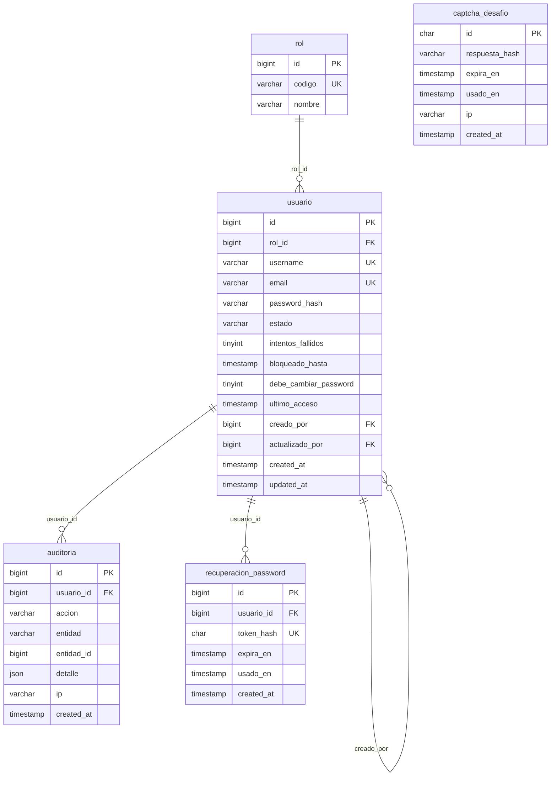
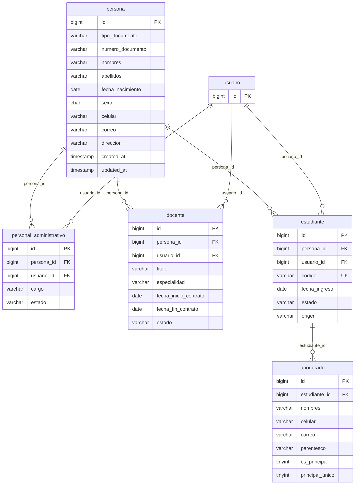
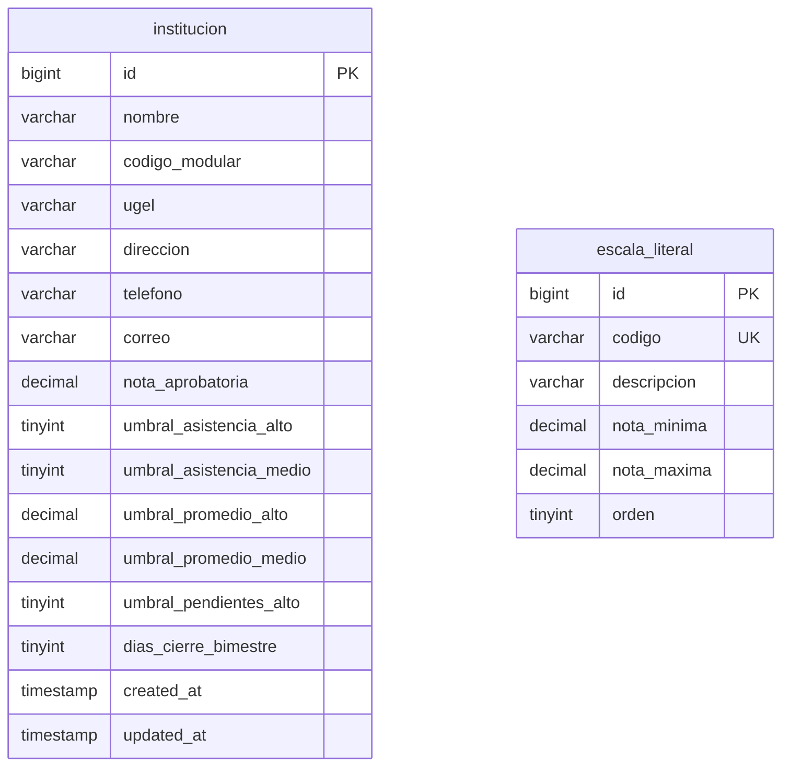
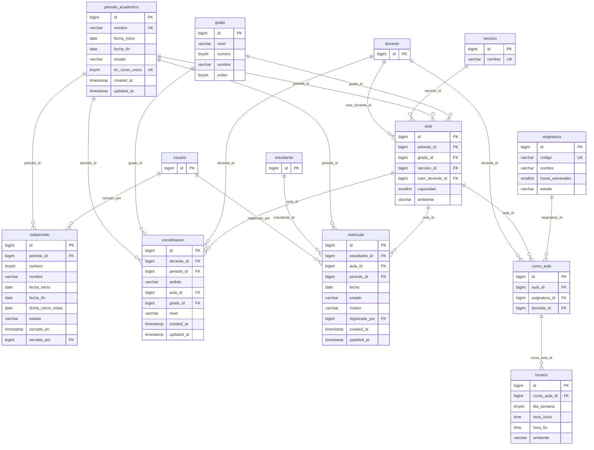
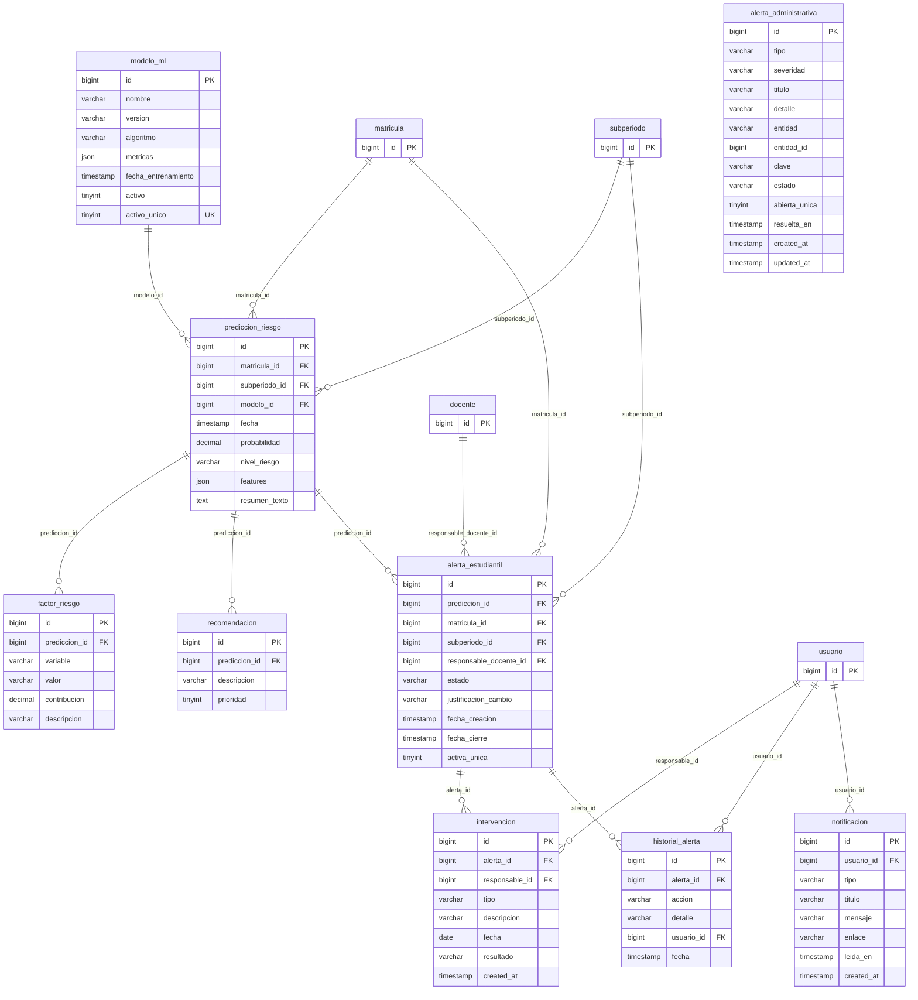

# Diagrama entidad-relación de AYNI

Generado desde la base de datos con `php artisan ayni:documentar-bd`. GitHub y VS Code muestran el diagrama directamente.

## Seguridad

## Personas

## Configuración

## Estructura académica

## Seguimiento académico

```mermaid
erDiagram
    usuario ||--o{ archivo : "subido_por"
    usuario ||--o{ evaluacion : "creado_por"
    curso_aula ||--o{ evaluacion : "curso_aula_id"
    subperiodo ||--o{ evaluacion : "subperiodo_id"
    tipo_evaluacion ||--o{ evaluacion : "tipo_evaluacion_id"
    archivo ||--o{ evaluacion_material : "archivo_id"
    evaluacion ||--o{ evaluacion_material : "evaluacion_id"
    archivo ||--o{ entrega : "archivo_id"
    evaluacion ||--o{ entrega : "evaluacion_id"
    matricula ||--o{ entrega : "matricula_id"
    evaluacion ||--o{ nota_evaluacion : "evaluacion_id"
    matricula ||--o{ nota_evaluacion : "matricula_id"
    usuario ||--o{ nota_evaluacion : "registrado_por"
    curso_aula ||--o{ calificacion_periodo : "curso_aula_id"
    matricula ||--o{ calificacion_periodo : "matricula_id"
    usuario ||--o{ calificacion_periodo : "publicado_por"
    subperiodo ||--o{ calificacion_periodo : "subperiodo_id"
    curso_aula ||--o{ sesion_clase : "curso_aula_id"
    usuario ||--o{ sesion_clase : "registrado_por"
    subperiodo ||--o{ sesion_clase : "subperiodo_id"
    matricula ||--o{ asistencia : "matricula_id"
    usuario ||--o{ asistencia : "modificado_por"
    usuario ||--o{ asistencia : "registrado_por"
    sesion_clase ||--o{ asistencia : "sesion_clase_id"
    matricula ||--o{ incidencia : "matricula_id"
    usuario ||--o{ incidencia : "registrado_por"
    tipo_incidencia ||--o{ incidencia : "tipo_incidencia_id"
    tipo_evaluacion {
        bigint id PK
        varchar nombre UK
        varchar estado
    }
    archivo {
        bigint id PK
        varchar disco
        varchar ruta
        varchar nombre_original
        varchar tipo_mime
        int tamano_bytes
        char hash_sha256
        bigint subido_por FK
        timestamp created_at
    }
    evaluacion {
        bigint id PK
        bigint curso_aula_id FK
        bigint subperiodo_id FK
        bigint tipo_evaluacion_id FK
        varchar titulo
        text indicaciones
        date fecha_asignacion
        date fecha_limite
        tinyint peso
        bigint creado_por FK
        timestamp created_at
        timestamp updated_at
    }
    evaluacion_material {
        bigint evaluacion_id PK
        bigint archivo_id PK
    }
    entrega {
        bigint id PK
        bigint evaluacion_id FK
        bigint matricula_id FK
        bigint archivo_id FK
        varchar estado
        timestamp entregada_en
        tinyint es_tardia
        timestamp created_at
        timestamp updated_at
    }
    nota_evaluacion {
        bigint id PK
        bigint evaluacion_id FK
        bigint matricula_id FK
        decimal nota
        varchar estado_entrega
        varchar observacion
        bigint registrado_por FK
        timestamp created_at
        timestamp updated_at
    }
    calificacion_periodo {
        bigint id PK
        bigint matricula_id FK
        bigint curso_aula_id FK
        bigint subperiodo_id FK
        decimal promedio
        varchar estado
        timestamp publicado_en
        bigint publicado_por FK
        timestamp cerrado_en
        timestamp created_at
        timestamp updated_at
    }
    sesion_clase {
        bigint id PK
        bigint curso_aula_id FK
        bigint subperiodo_id FK
        date fecha
        varchar tema
        varchar estado
        bigint registrado_por FK
        timestamp created_at
        timestamp updated_at
    }
    asistencia {
        bigint id PK
        bigint sesion_clase_id FK
        bigint matricula_id FK
        char estado
        varchar observacion
        bigint registrado_por FK
        bigint modificado_por FK
        timestamp created_at
        timestamp updated_at
    }
    tipo_incidencia {
        bigint id PK
        varchar nombre UK
        varchar descripcion
    }
    incidencia {
        bigint id PK
        bigint matricula_id FK
        bigint tipo_incidencia_id FK
        bigint registrado_por FK
        date fecha
        varchar gravedad
        varchar descripcion
        timestamp created_at
        timestamp updated_at
    }
    usuario {
        bigint id PK
    }
    curso_aula {
        bigint id PK
    }
    subperiodo {
        bigint id PK
    }
    matricula {
        bigint id PK
    }
```

## Riesgo, alertas y notificaciones

