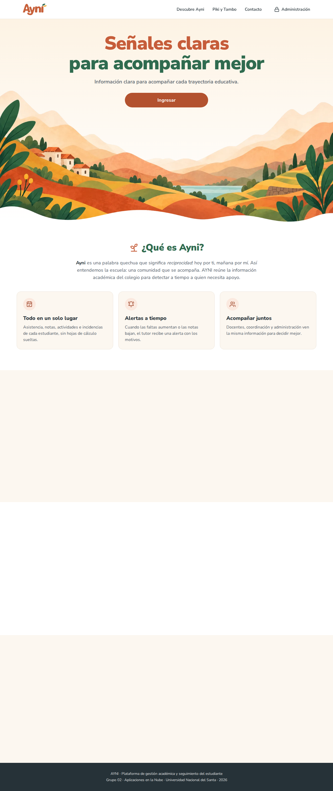
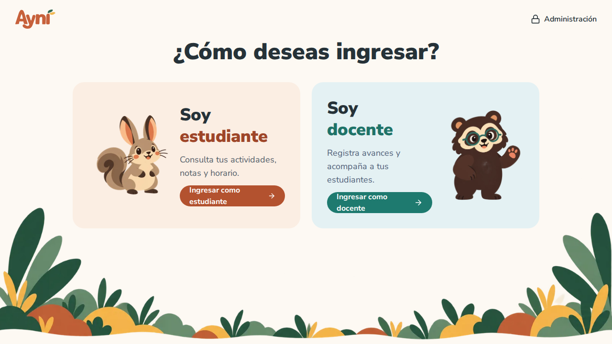
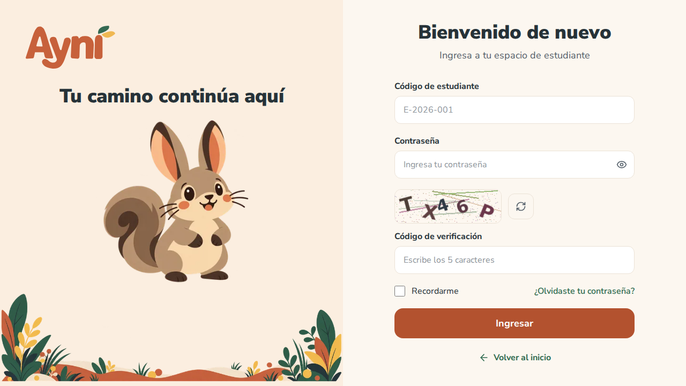
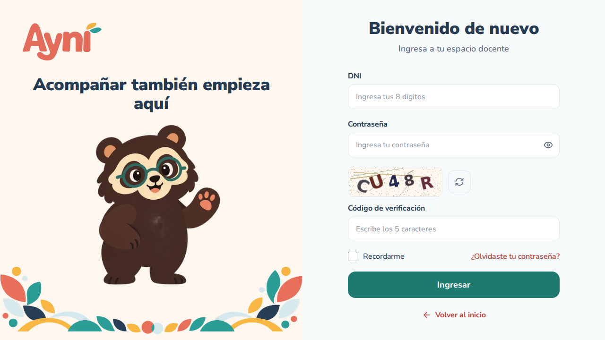
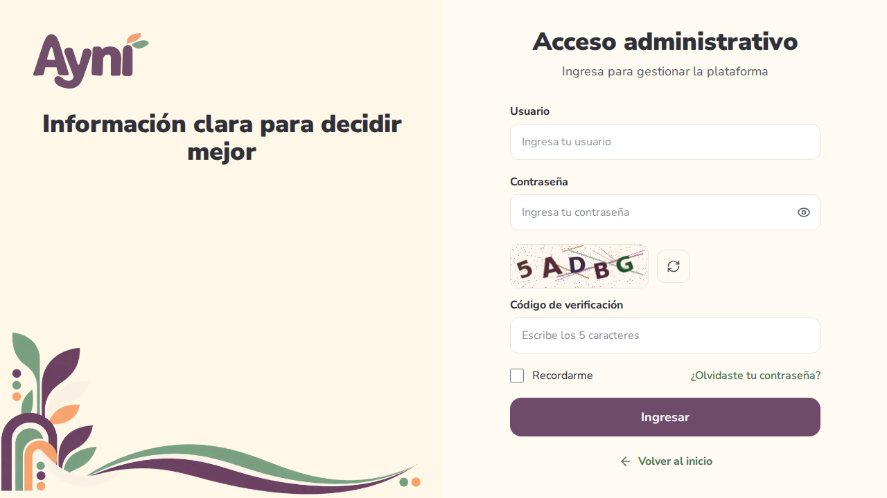
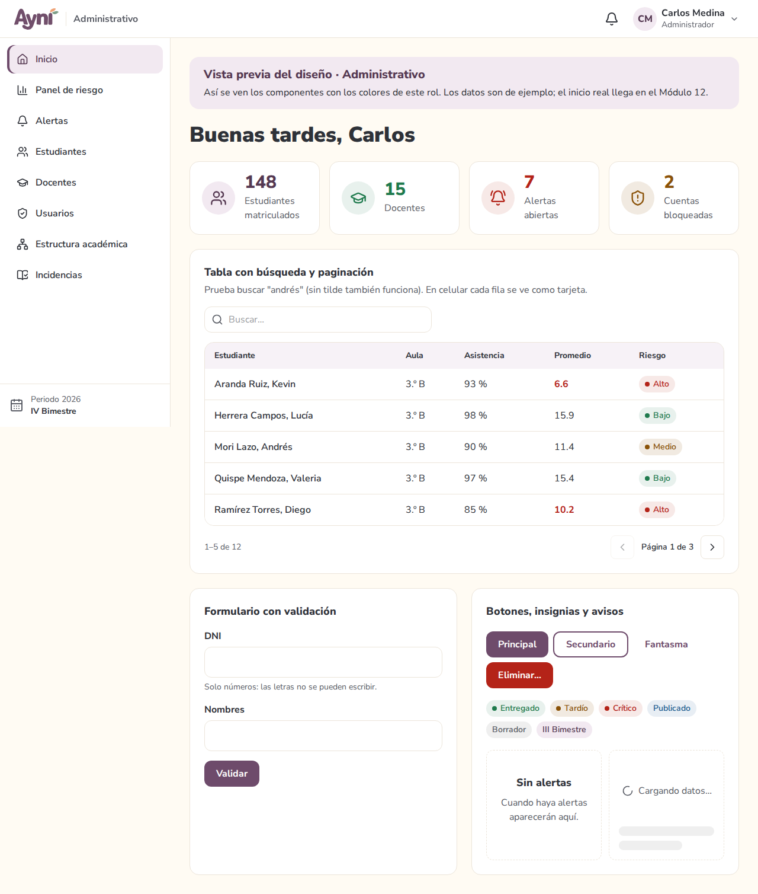
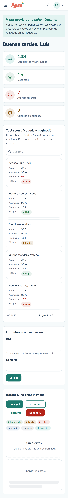
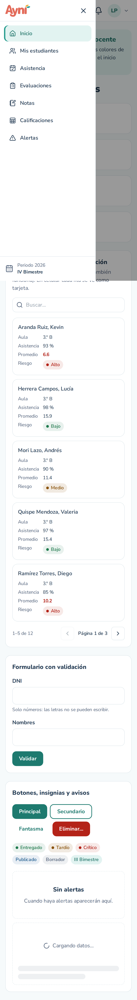

# Manual de usuario — Acceso y navegación

> Sección del Módulo 3. El inicio de sesión, el captcha y la recuperación de contraseña están en `usuario-02-inicio-de-sesion.md`.

## 1. Página de inicio

Al abrir AYNI aparece la página de inicio, con:
- el mensaje **"Señales claras para acompañar mejor"** y el botón **Ingresar**;
- las secciones **¿Qué es Ayni?**, **Descubre Ayni**, **Piki y Tambo** y **Contacto**, a las que se llega con el menú superior;
- el enlace **Administración** (arriba a la derecha), que lleva al acceso del personal administrativo.

## 2. Elegir cómo ingresar

El botón **Ingresar** lleva a **"¿Cómo deseas ingresar?"**:
- **Soy estudiante** (acompañado por Piki, la vizcacha);
- **Soy docente** (acompañado por Tambo, el oso de anteojos). Los coordinadores ingresan por aquí.

## 3. Pantallas de ingreso

Cada tipo de usuario tiene su pantalla, con sus propios colores:

| Usuario | Qué se escribe en el primer campo | Ejemplo |
|---|---|---|
| Estudiante | Código de estudiante (se pasa solo a mayúsculas) | `E-2026-001` |
| Docente o coordinador | DNI (solo acepta números, 8 dígitos) | `41234567` |
| Administrativo | Nombre de usuario | `cmedina` |

Antes de enviar, AYNI revisa el formato y muestra el error en rojo bajo el campo (el ingreso completo, con el código de la imagen, se explica en la sección siguiente del manual). Por ejemplo: "El DNI debe tener 8 dígitos." El ícono del ojo muestra u oculta la contraseña.

| Estudiante | Docente | Administrativo |
|---|---|---|
|  |  |  |

## 4. Navegación dentro del sistema

Todas las pantallas internas comparten la misma estructura:
- **Barra superior:** logo, tipo de usuario, campana de notificaciones y menú de la cuenta (Mi perfil, Cerrar sesión).
- **Menú lateral:** las opciones del rol. La opción actual se resalta.
- **Pie del menú:** el periodo y el bimestre en curso.
- **Colores por rol:** terracota y verde para estudiantes, turquesa y coral para docentes, ciruela y salvia para administración.

| Rol | Opciones del menú |
|---|---|
| Administrativo | Inicio, Panel de riesgo, Alertas, Estudiantes, Docentes, Usuarios, Estructura académica, Incidencias |
| Docente | Inicio, Mis estudiantes, Asistencia, Evaluaciones, Notas, Calificaciones, Alertas |
| Estudiante | Inicio, Mis notas, Mi asistencia, Mi horario, Actividades, Notificaciones |

### En el celular

El menú lateral se oculta y se abre con el botón **☰** de la barra superior. Se cierra con la **X**, tocando fuera del menú o al elegir una opción. Las tablas se muestran como tarjetas.

| Pantalla | Menú abierto |
|---|---|
|  |  |

## 5. Elementos comunes

- **Tablas:** buscador (no distingue tildes ni mayúsculas) y paginación.
- **Formularios:** el error se muestra junto a cada campo. Algunos campos impiden escribir caracteres inválidos; por ejemplo, el DNI no acepta letras.
- **Avisos:** mensajes breves abajo a la derecha (verde: éxito, rojo: error, azul: información). Se cierran solos o con la **X**.
- **Confirmaciones:** antes de una acción que no se puede deshacer aparece una ventana para confirmar o cancelar (también con la tecla **Esc**).
- **Página no encontrada (404):** aparece si la dirección no existe; tiene un botón para volver al inicio.
- **Sin permiso (403):** aparece si se intenta abrir una sección de otro tipo de usuario.

## 6. Estado del sistema

La dirección `/estado` (por ejemplo, http://localhost:5173/estado) muestra si la web, la API y la base de datos están funcionando, con sus versiones. Es útil para revisar la instalación.
