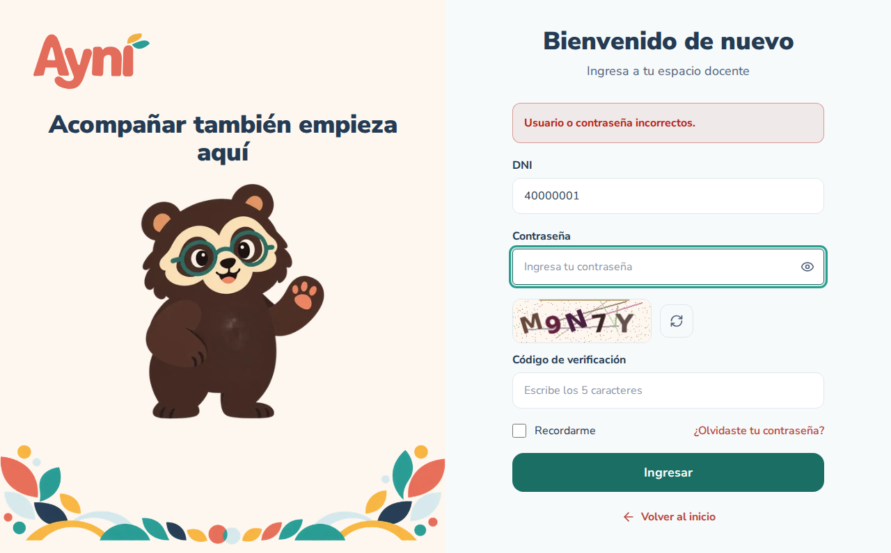
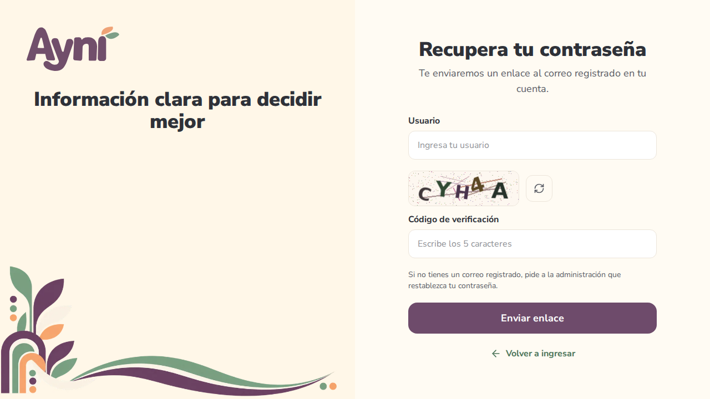
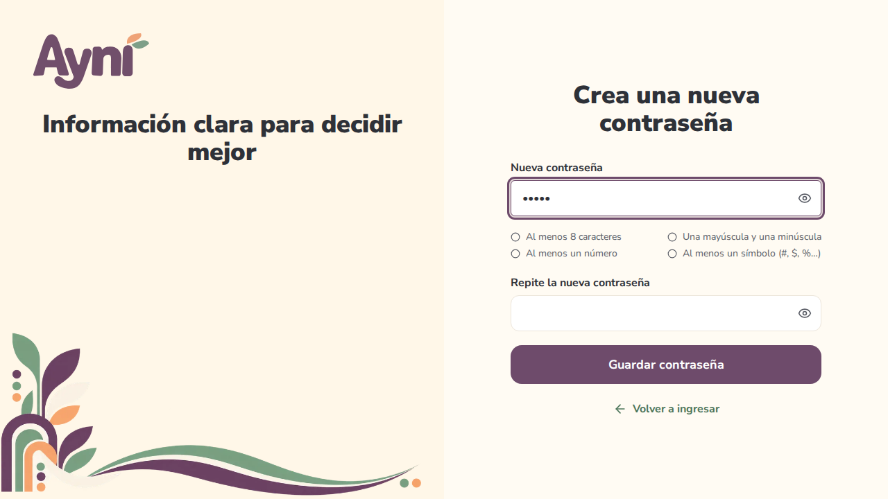

# Manual de usuario — Inicio de sesión, contraseña y cierre de sesión

> Sección del Módulo 4.

## 1. Requisitos de acceso

| Usuario | Entra por | Usuario | Contraseña |
|---|---|---|---|
| Estudiante | **Ingresar → Soy estudiante** | Código de estudiante (`E-2026-001`) | Mínimo 8 caracteres, con letras y números |
| Docente o coordinador | **Ingresar → Soy docente** | DNI (8 dígitos) | Mínimo 8 caracteres, con mayúscula, minúscula, número y símbolo |
| Administrativo | **Administración** (arriba a la derecha) | Nombre de usuario (`cmedina`) | Igual que el docente |

La cuenta la crea la administración del colegio, que entrega una **contraseña temporal**. En el primer ingreso AYNI pide cambiarla (ver "Cambiar la contraseña temporal").

**Dónde se abre:** en la web, https://ayni.ruta-practica.com/ (computadora o celular, con cualquier navegador actualizado); en una instalación local, http://localhost:5173.

**Cuentas de demostración** (colegio ficticio "IEP El Señor es mi Pastor"), para probar cada rol:

| Rol | Usuario | Contraseña | Entra por |
|---|---|---|---|
| Administrador | `cmedina` | `Ayni#2026` | **Administración** |
| Docente que coordina el 3.º A | `41234567` | `Ayni#2026` | **Ingresar → Soy docente** |
| Docente, tutora del 3.º B | `42345678` | `Ayni#2026` | **Ingresar → Soy docente** |
| Estudiante de secundaria (3.º B) | `E-2026-001` | `piki2026` | **Ingresar → Soy estudiante** |
| Estudiante de primaria (4.º) | `E-2026-002` | `piki2026` | **Ingresar → Soy estudiante** |

Cinco intentos fallidos bloquean la cuenta (ver "Cuenta bloqueada"). Si pruebas en grupo, que cada persona use una cuenta distinta para no bloquearse entre sí.

## 2. Iniciar sesión

1. Abre la pantalla de ingreso de tu tipo de usuario.
2. Escribe tu usuario y tu contraseña.
3. Escribe los **5 caracteres de la imagen** (código de verificación). No importa si usas mayúsculas o minúsculas. Si no se lee bien, pulsa el botón **⟳** junto a la imagen para cambiarla.
4. Marca **Recordarme** si quieres que AYNI deje escrito tu usuario la próxima vez (en esa computadora o celular). La contraseña nunca se guarda.
5. Pulsa **Ingresar**. Entrarás al inicio de tu rol, con tu nombre arriba a la derecha.

Cada imagen sirve **una sola vez** y vence a los **5 minutos**. Si te equivocas, AYNI muestra una imagen nueva.

### Mensajes que puedes ver

| Mensaje | Qué hacer |
|---|---|
| "Usuario o contraseña incorrectos." | Revisa ambos datos. Por seguridad, AYNI no dice cuál de los dos está mal. |
| "Te quedan 2 intentos antes de que la cuenta se bloquee." | Aparece cuando quedan pocos intentos. Si no recuerdas la contraseña, usa **¿Olvidaste tu contraseña?** |
| "El código de verificación no es correcto o ya venció." | Escribe el código de la nueva imagen. |
| "Tu cuenta está bloqueada…" | Ver la sección 6. |
| "Tu cuenta está inactiva…" | Comunícate con la administración del colegio. |
| "Demasiadas solicitudes…" | Espera un minuto e inténtalo de nuevo. |

## 3. Recuperar la contraseña

Sirve para quien tiene un **correo registrado** en su cuenta.

1. En la pantalla de ingreso, pulsa **¿Olvidaste tu contraseña?**
2. Escribe tu usuario y el código de la imagen, y pulsa **Enviar enlace**.
3. AYNI responde siempre lo mismo, exista o no la cuenta (así nadie puede averiguar qué usuarios existen). Si la cuenta tiene correo, llegará un mensaje **"Restablecer tu contraseña"**.
4. Abre el enlace del correo. Sirve **una sola vez** y vence a los **30 minutos**.
5. Escribe la nueva contraseña dos veces. La lista de requisitos se marca en verde a medida que los cumples.
6. Al guardar, se cierran las sesiones abiertas en otros equipos. Ya puedes ingresar con la nueva contraseña.

Quien no tenga correo registrado debe pedir a la administración que restablezca su contraseña (los estudiantes también pueden pedírselo a su tutor).

| Pedir el enlace | Crear la nueva contraseña |
|---|---|
|  |  |

> **En la instalación local** los correos no salen a internet: se ven en **Correos de prueba** (opción 13 del panel, http://localhost:8025).

## 4. Cambiar la contraseña temporal

Si la administración te dio una contraseña temporal, al ingresar aparece **"Crea tu contraseña"**:

1. Escribe la contraseña temporal.
2. Escribe y repite la nueva contraseña. Debe cumplir los requisitos de tu rol y no puede ser igual a tu usuario ni a la temporal.
3. Pulsa **Guardar y continuar**.

Hasta que la cambies no puedes usar el resto del sistema. Si prefieres hacerlo después, pulsa **Cerrar sesión**.

## 5. Cerrar sesión

- **A pedido:** abre el menú de tu cuenta (tu nombre, arriba a la derecha) y elige **Cerrar sesión**. Haz esto siempre en computadoras compartidas.
- **Por inactividad:** si pasa **1 hora sin usar AYNI**, la sesión se cierra sola y aparece el aviso "Tu sesión se cerró por inactividad. Vuelve a ingresar."

Si escribes la dirección de una pantalla sin haber ingresado, AYNI te lleva a ingresar y, al terminar, te devuelve a esa pantalla. Si intentas abrir la sección de otro tipo de usuario, verás la página **"No tienes permiso para ver esta página"**.

## 6. Cuenta bloqueada

Después de **5 intentos fallidos seguidos**, la cuenta se bloquea y, si tiene correo, AYNI envía un aviso.

| Usuario | Cómo se desbloquea |
|---|---|
| Estudiante o docente | La administración la desbloquea (pantalla **Usuarios**, Módulo 5). |
| Administrativo | Sola, a los 15 minutos. |

## 7. Problemas frecuentes

| Problema | Solución |
|---|---|
| La imagen del código no carga | Revisa tu conexión y pulsa **⟳**. |
| El correo de recuperación no llega | Revisa la carpeta de spam. Si tu cuenta no tiene correo registrado, pide ayuda a la administración. |
| "El enlace no es válido o ya venció" | Ya se usó o pasaron más de 30 minutos. Pide otro con **Solicitar otro enlace**. |
| Me saca del sistema a cada rato | La sesión se cierra tras 1 hora sin actividad. También se cierra si cambiaste la contraseña en otro equipo. |
| Entro como estudiante y me dice "Esta cuenta es de docente" | Usa la pantalla de ingreso que corresponde a tu cuenta. |
