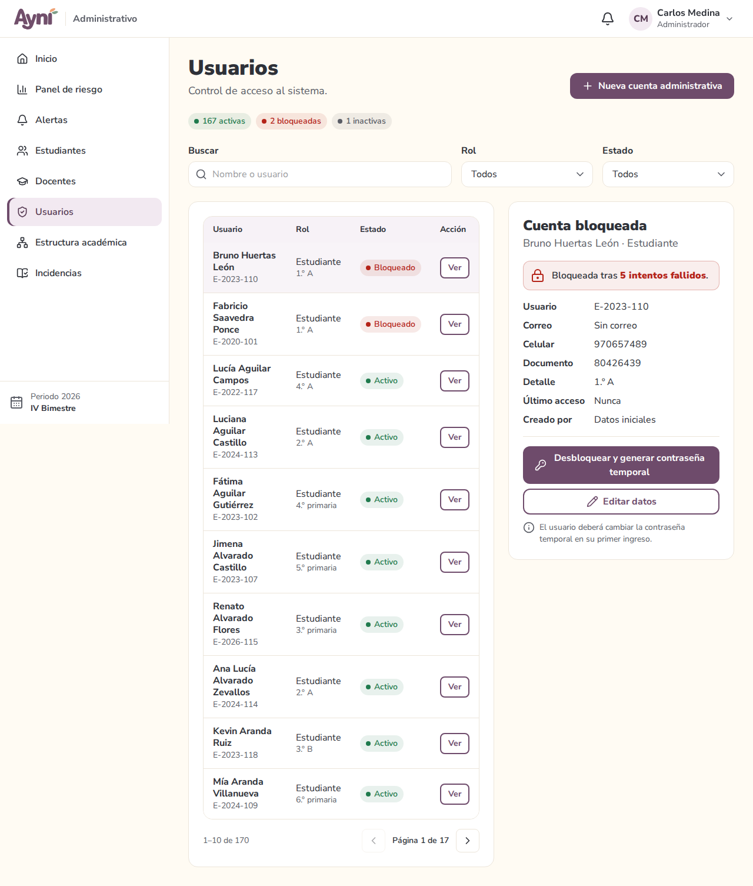
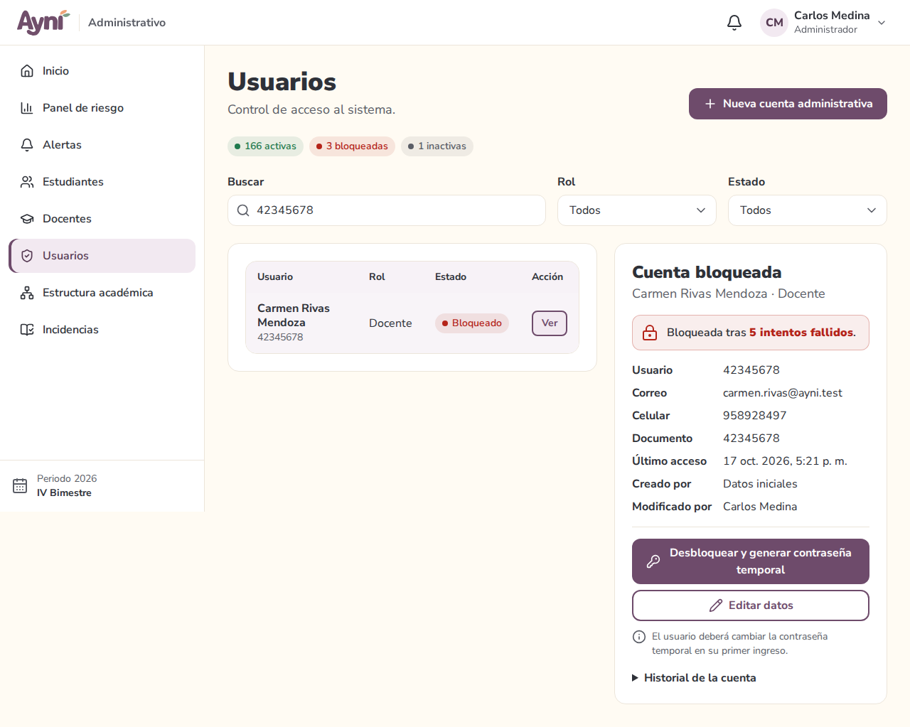
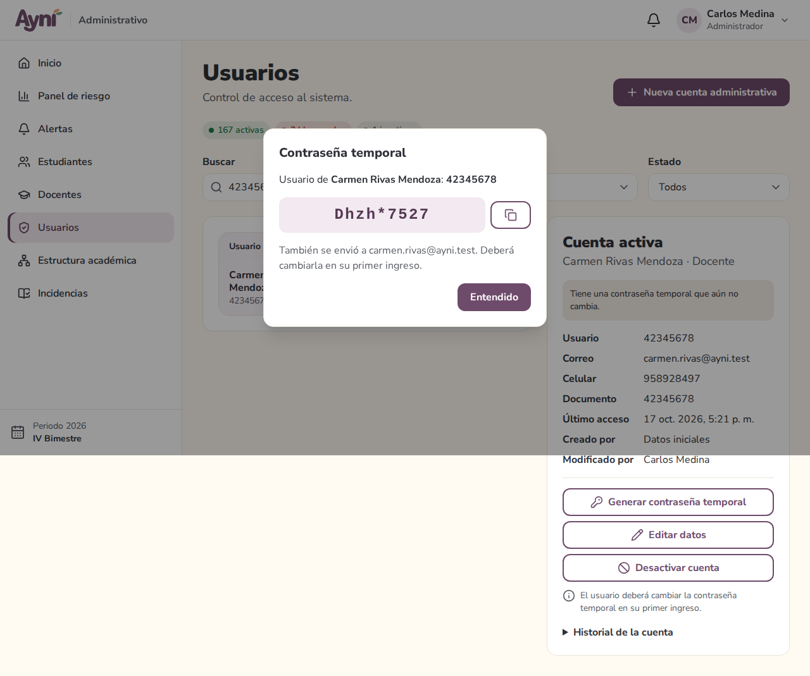
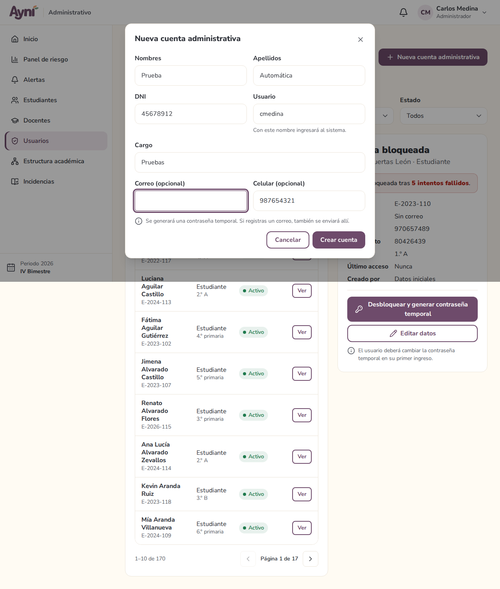
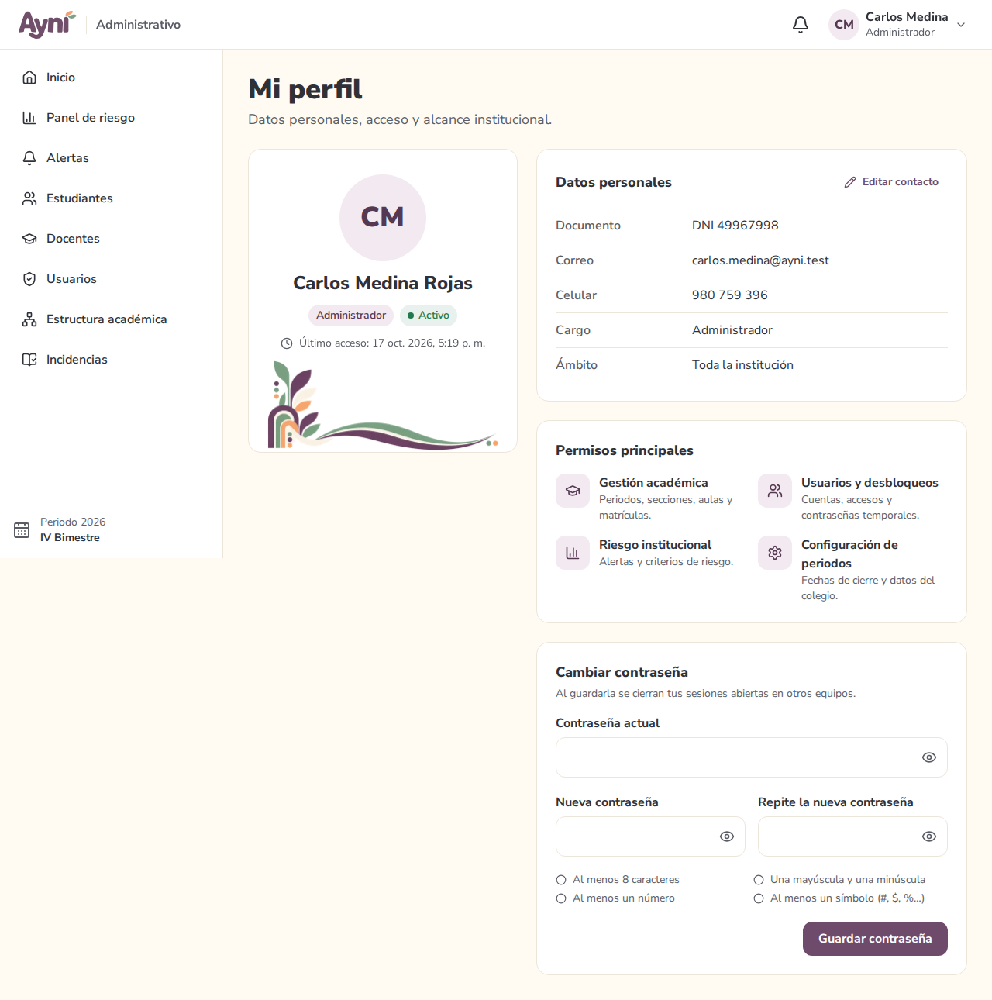
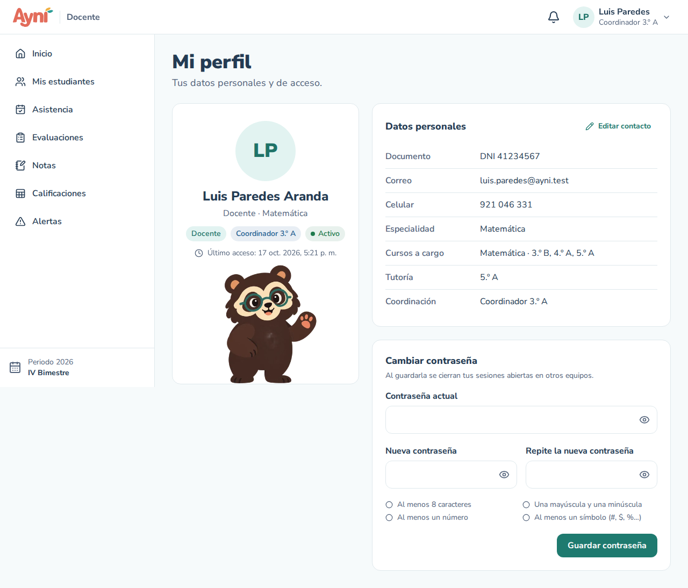
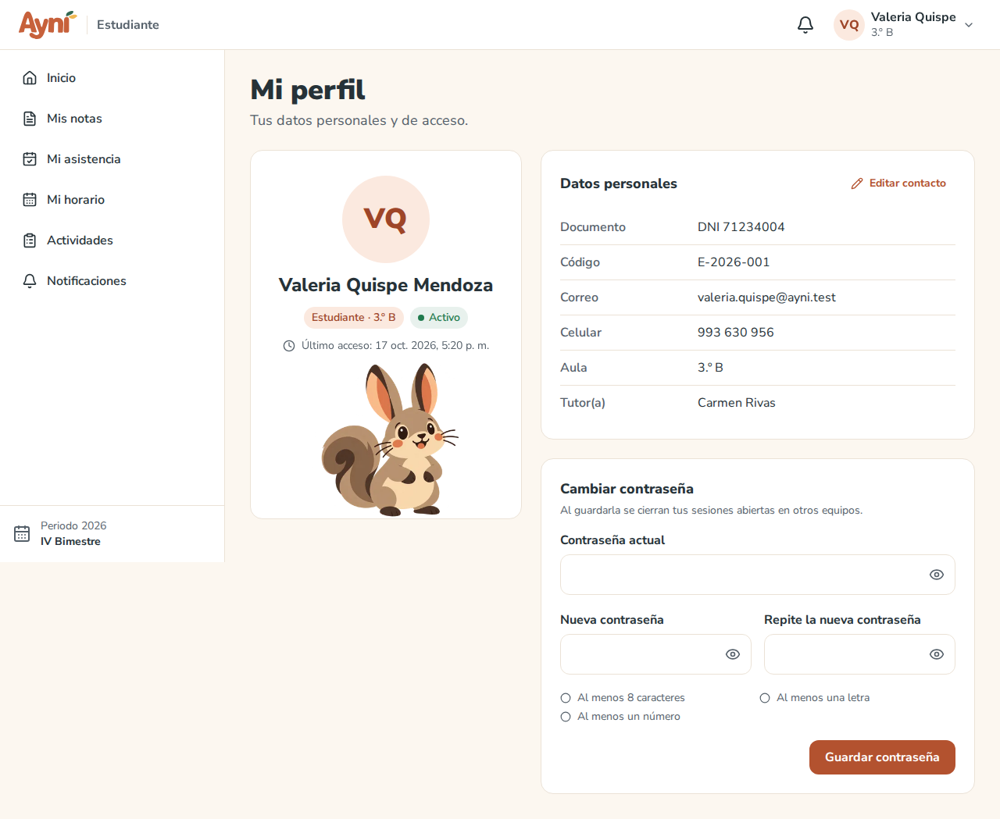

# Manual de usuario — Usuarios (administración) y Mi perfil

> Sección del Módulo 5.

## 1. Administrador → Usuarios

Menú lateral → **Usuarios**. Aquí se controla quién puede entrar al sistema.

### Buscar y filtrar

- **Buscar:** por nombre o usuario (DNI del docente, código del estudiante). No importan las tildes ni las mayúsculas.
- **Rol** y **Estado:** listas para ver, por ejemplo, solo las cuentas bloqueadas.
- Arriba se ve el resumen: cuentas activas, bloqueadas e inactivas.
- Las cuentas **bloqueadas aparecen primero**, porque piden atención. La lista se pagina de 10 en 10.

### Ver una cuenta

Pulsa **Ver**. En la computadora la cuenta se abre en el panel de la derecha; en el celular, en una ventana. Se muestra:
- estado (**activa**, **bloqueada** o **inactiva**) y, si está bloqueada, cuántos intentos fallidos tuvo;
- usuario, correo, celular, documento, cargo o aula, último acceso;
- quién creó la cuenta y quién la modificó por última vez;
- **Historial de la cuenta** (se despliega): creación, ediciones, bloqueos, desbloqueos y cambios de contraseña, con fecha y autor.

### Desbloquear y generar contraseña temporal

1. Abre la cuenta bloqueada y pulsa **Desbloquear y generar contraseña temporal**. En una cuenta que no está bloqueada el botón dice **Generar contraseña temporal** (sirve cuando alguien olvidó su clave y no tiene correo).
2. Confirma. La contraseña anterior deja de servir y se cierran las sesiones abiertas de esa persona.
3. Aparece la **contraseña temporal**. Cópiala con el botón o díctala: **no se vuelve a mostrar**. Si la cuenta tiene correo, también se le envía.
4. Al ingresar con ella, el sistema le pide crear una contraseña nueva.

| Cuenta bloqueada | Contraseña temporal |
|---|---|
|  |  |

Las contraseñas temporales cumplen la política de cada rol y no usan caracteres que se confunden (l, I, O, 0, 1). Ejemplos: estudiante `kmpa4827`; docente o administrativo `Tqmz#4821`.

### Desactivar y activar

- **Desactivar cuenta:** la persona ya no puede ingresar y se cierran sus sesiones. Sus datos no se borran.
- **Activar cuenta:** vuelve a ingresar con su contraseña de siempre.
- Una cuenta **bloqueada** no se activa con este botón: se libera con la contraseña temporal.
- No puedes desactivar tu propia cuenta, y siempre debe quedar al menos un administrativo activo.

### Nueva cuenta administrativa

Botón **Nueva cuenta administrativa**: nombres, apellidos, DNI, usuario, cargo y, de forma opcional, correo y celular. Al crearla aparece su contraseña temporal.

Las cuentas de **docentes y estudiantes** se crean al registrarlos en **Docentes** y **Estudiantes** (Módulo 7). Desde Usuarios solo se cambia su correo y celular; sus demás datos se editan en su ficha.

### Reglas de los campos

| Campo | Regla |
|---|---|
| Nombres y apellidos | 2 a 100 letras; se permiten tildes, ñ, espacios, apóstrofo y guion. Se guardan con mayúscula inicial |
| DNI | 8 dígitos; no se repite |
| Usuario | 4 a 30 caracteres; empieza con letra; solo letras, números, punto y guion bajo; no se repite |
| Cargo | 2 a 80 caracteres |
| Correo | usuario@dominio.com; no puede ser de otra cuenta |
| Celular | 9 dígitos y empieza con 9 |

## 2. Mi perfil (todos los usuarios)

Menú de tu nombre (arriba a la derecha) → **Mi perfil**.

| Administrativo | Docente | Estudiante |
|---|---|---|
|  |  |  |

- **Tu tarjeta:** iniciales, nombre completo, rol, estado y último acceso.
- **Datos personales:** documento y correo y celular, más lo propio de tu rol:
  - estudiante: código, aula y tutor(a);
  - docente: especialidad, cursos a cargo, tutoría y coordinación;
  - administrativo: cargo y ámbito, además de sus **permisos principales**.
- **Editar contacto:** cambia tu correo y tu celular. El correo sirve para recuperar la contraseña; puedes dejarlo vacío.
- **Cambiar contraseña:** escribe la actual y dos veces la nueva. La lista de requisitos se marca en verde. Al guardar se cierran tus sesiones en otros equipos (la actual sigue abierta).

Los demás datos (nombres, documento, aula…) los corrige la administración.

## 3. Problemas frecuentes

| Problema | Solución |
|---|---|
| "Ese correo ya lo usa otra cuenta" | Cada correo pertenece a una sola cuenta. Usa otro o pide a la administración que revise la otra cuenta |
| Perdí la contraseña temporal antes de entregarla | Vuelve a pulsar **Generar contraseña temporal**: la anterior deja de servir |
| No aparece el botón para desactivar | Es tu propia cuenta, o la cuenta está bloqueada (primero desbloquéala) |
| "Debe quedar al menos una cuenta administrativa activa" | Activa o crea otra cuenta administrativa antes de desactivar esta |
