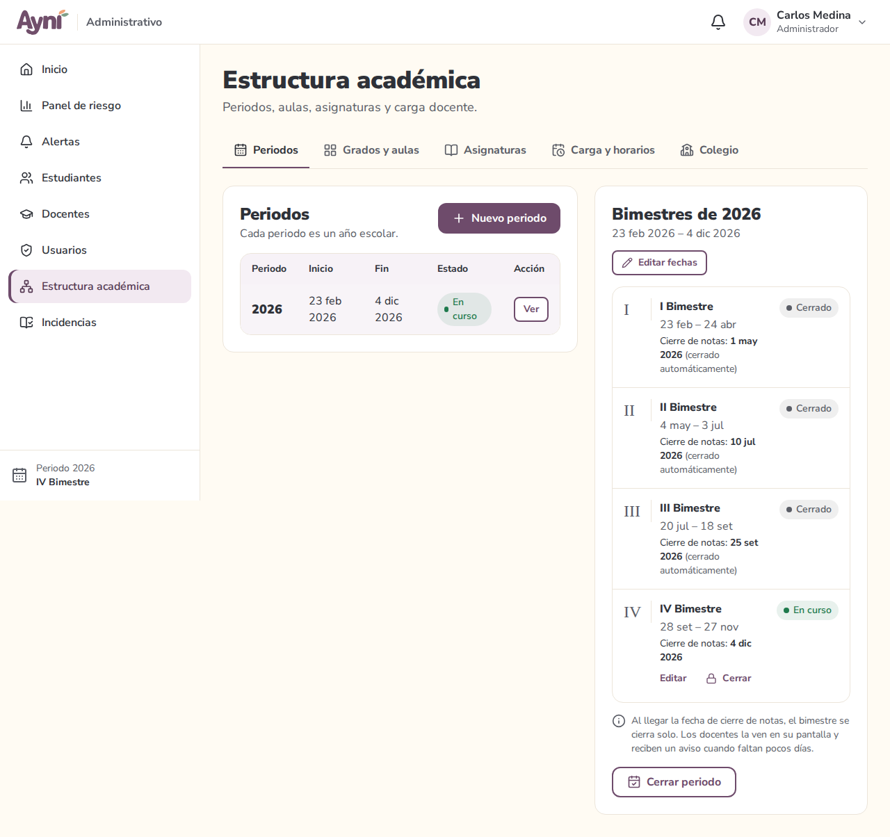
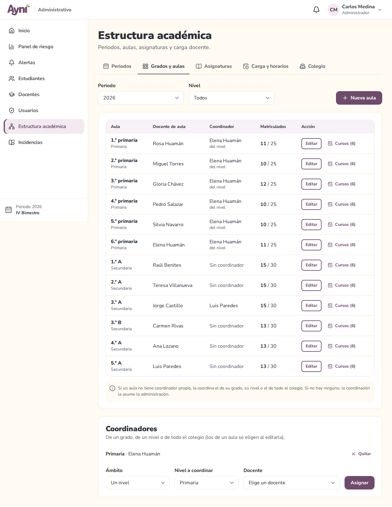
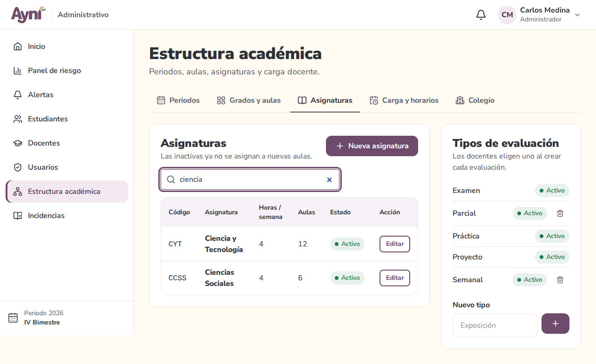
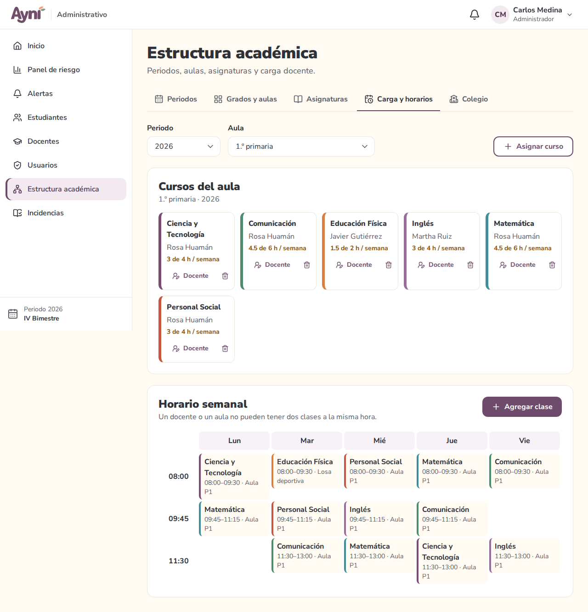
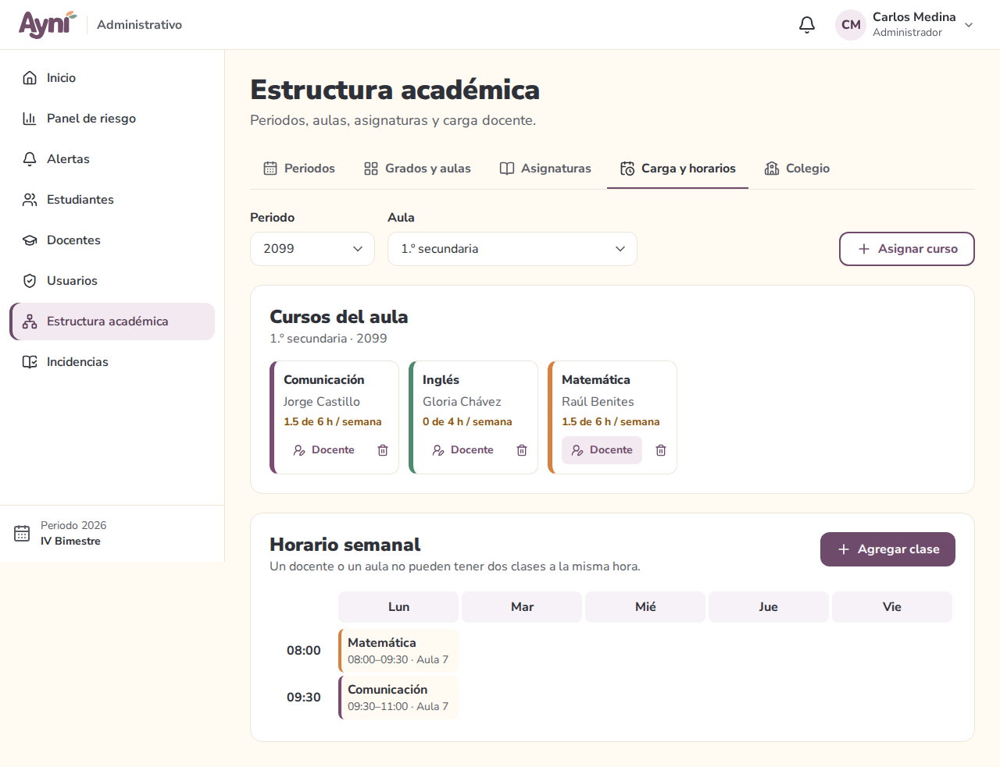
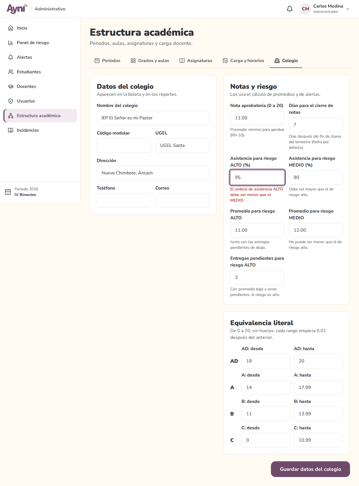

# Manual de usuario — Administrador → Estructura académica

> Sección del Módulo 6.

Menú lateral → **Estructura académica**. Tiene cinco pestañas: **Periodos**, **Grados y aulas**, **Asignaturas**, **Carga y horarios** y **Colegio**. La pestaña elegida queda en la dirección de la página, así que se puede guardar como favorito.

## 1. Periodos y bimestres

Cada **periodo** es un año escolar. A la izquierda está la lista; a la derecha, los 4 bimestres del periodo elegido (pulsa **Ver** para cambiarlo).

### Crear un periodo

1. **Nuevo periodo**: escribe el año (de 2020 a 2100) y las fechas de inicio y fin.
2. La fecha de fin **incluye el cierre de notas del IV bimestre**: elige una fecha que deje a los docentes unos días después de terminar las clases.
3. El periodo queda **Planificado**. Define sus bimestres con **Definir**.

### Definir un bimestre

| Campo | Regla |
|---|---|
| Inicio y fin de clases | Dentro del periodo. No se cruzan con otros bimestres y van en orden (el II después del I) |
| Cierre de notas | No antes del inicio del bimestre ni después del fin del periodo (RN-02). Si lo dejas vacío: fin de clases + los días configurados en **Colegio** (7 por defecto) |

**Al llegar la fecha de cierre, el bimestre se cierra solo.** No hace falta que nadie entre ese día: el sistema lo revisa cada vez que alguien lo usa. Los docentes ven la fecha y, cuando faltan 7 días o menos, un aviso en todas sus pantallas.

Si hace falta, **Cerrar** cierra un bimestre antes de su fecha. Un bimestre cerrado ya no cambia sus fechas.

### Estados

| Periodo | Significado |
|---|---|
| **Planificado** | En preparación. Se puede editar o eliminar (si aún no tiene aulas) |
| **En curso** | El año actual. Solo puede haber uno (RN-01) |
| **Cerrado** | Terminado. Ya no se modifica ni se vuelve a abrir |

| Bimestre | Significado |
|---|---|
| **Pendiente** | Aún no empiezan sus clases |
| **En curso** | Hoy está dentro de sus fechas de clase |
| **Notas abiertas** | Terminaron las clases, pero aún no llega la fecha de cierre |
| **Cerrado** | Ya no se registran notas. "(cerrado automáticamente)" indica que lo cerró el sistema |
| **Sin definir** | Aún no tiene fechas |

Para pasar al año siguiente: crea el nuevo periodo y sus bimestres, **cierra el periodo actual** (también cierra sus bimestres abiertos) y luego **inicia** el nuevo.

## 2. Grados y aulas

Elige el **periodo** y, si quieres, el **nivel**. Cada fila es un aula, con su docente de aula (tutor), su coordinador y cuántos matriculados tiene frente a su capacidad.

### Crear o editar un aula

| Campo | Regla |
|---|---|
| Grado y sección | La sección es **Única** o una letra (A, B, C…). Un grado con sección Única no puede tener otras secciones, y viceversa (RN-03). No se repite grado y sección en el mismo periodo |
| Capacidad | De 1 a 60. No puede ser menor que los matriculados |
| Ambiente | Opcional (por ejemplo, "Aula 12"). Se usa por defecto en su horario |
| Docente de aula (tutor) | Un docente es tutor de un solo aula por periodo |
| Coordinador propio del aula | Opcional |

El grado y la sección no se cambian al editar. Un aula sin matrículas ni cursos se puede **eliminar**. El botón **Cursos** lleva directo a su carga y horario.

### Coordinadores

Abajo se asignan coordinadores de **un grado**, **un nivel** o **todo el colegio** (uno por ámbito). Un aula sin coordinador propio toma el de su grado; si no hay, el de su nivel; y si tampoco, el del colegio. En la tabla se indica de dónde viene ("del grado", "del nivel"…). Si no hay ninguno, la coordinación la asume la administración.

## 3. Asignaturas y tipos de evaluación

| Campo | Regla |
|---|---|
| Código | 2 a 20 caracteres: letras, números y guion; se guarda en mayúsculas; no se repite |
| Nombre | 3 a 100 caracteres: letras, números y espacios |
| Horas por semana | De 1 a 20 |
| Estado | Una asignatura **inactiva** ya no se asigna a nuevas aulas (las que ya la tienen la conservan) |

Una asignatura que se dicta en algún aula no se puede eliminar: inactívala.

**Tipos de evaluación** (Práctica, Examen, Proyecto…): los docentes eligen uno al crear cada evaluación. Pulsa el estado para activarlo o inactivarlo. Solo se eliminan los que ninguna evaluación usa.

## 4. Carga y horarios

Elige el **periodo** y el **aula**.

- **Cursos del aula:** cada asignatura con su docente y las horas programadas frente a las de la asignatura (en naranja si faltan). **Asignar curso** agrega una asignatura con su docente; **Docente** lo cambia.
- **Horario semanal:** **Agregar clase** pide el curso, el día (lunes a sábado), la hora de inicio y fin (entre 06:00 y 20:00, mínimo 30 minutos) y el ambiente. Pulsa una clase de la grilla para editarla o quitarla.

**El sistema no permite cruces (RN-05):**
- el aula no puede tener dos clases a la vez;
- un docente no puede dictar en dos aulas a la vez (en el mismo periodo);
- al cambiar el docente de un curso, se revisa que sus clases no choquen con las que ya dicta.

El mensaje dice con qué choca, por ejemplo: "Cruce de horario: Luis Paredes ya dicta Matemática en 3.º A el lunes de 08:00 a 09:30". Las clases seguidas (una termina a las 09:30 y otra empieza a las 09:30) no son cruce.

Un curso que ya tiene evaluaciones, asistencia o notas no se puede quitar: cambia su docente si hace falta. En el celular, el horario se muestra como una lista por día.

## 5. Colegio

- **Datos del colegio:** nombre, código modular (7 dígitos), UGEL, dirección, teléfono y correo. Aparecen en la boleta y los reportes.
- **Notas y riesgo:** nota aprobatoria, días para el cierre de notas y los umbrales que usarán las alertas (Módulo 11). El umbral de asistencia de riesgo ALTO debe ser menor que el de MEDIO; el de promedio ALTO, no mayor que el de MEDIO.
- **Equivalencia literal:** rangos de C a AD que cubren de 0 a 20 sin huecos ni cruces; cada rango empieza 0,01 después del anterior (por defecto C 0–10,99, B 11–13,99, A 14–17,99, AD 18–20).

## 6. Problemas frecuentes

| Problema | Solución |
|---|---|
| "Ya hay un periodo en curso" al iniciar otro | Cierra primero el periodo actual |
| "Define al menos el I Bimestre antes de iniciar el periodo" | Pulsa **Definir** en el I Bimestre |
| "La fecha de cierre de notas no puede ser… posterior al fin del periodo" | Amplía el fin del periodo (**Editar fechas**) o elige otra fecha de cierre |
| No aparece la sección A para un grado | Ese grado tiene sección Única en el periodo |
| No se puede eliminar un aula, una asignatura o un curso | Ya tiene matrículas, cursos, evaluaciones o asistencia. Inactiva la asignatura o cambia el docente del curso |
| El aula no aparece en Carga y horarios | Revisa que esté elegido el periodo correcto |
