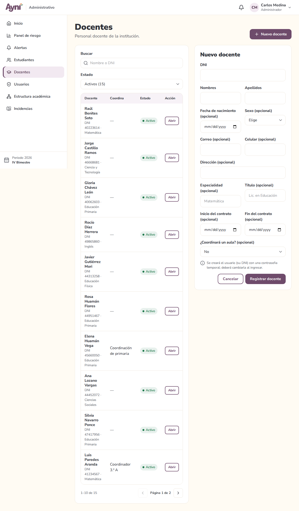
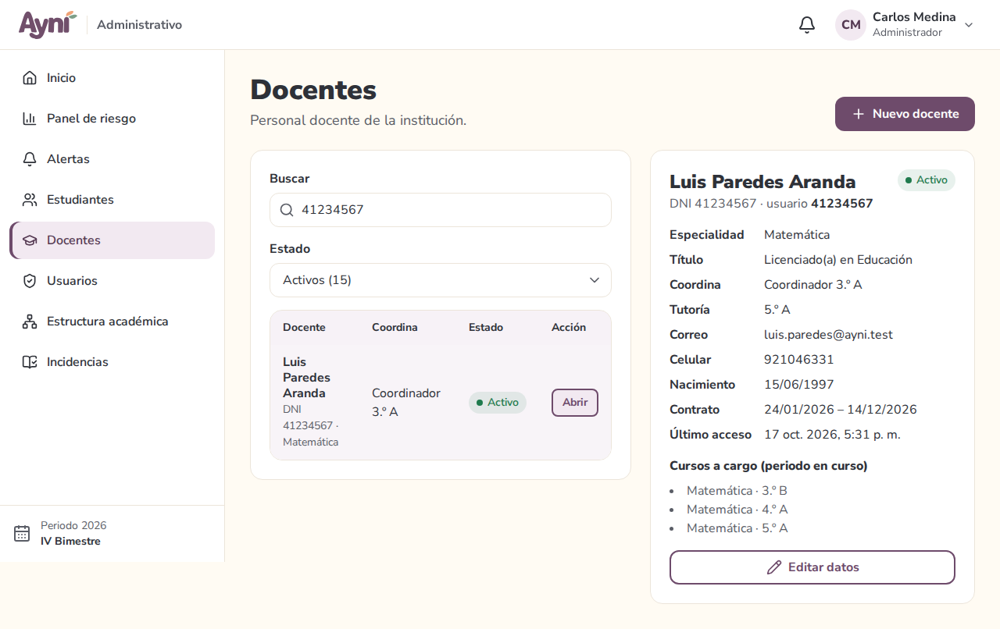
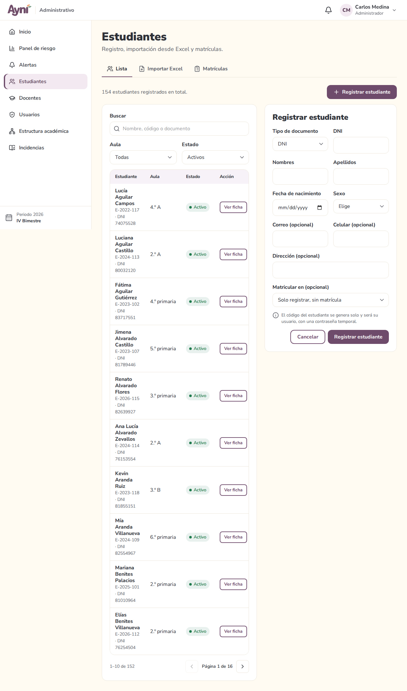
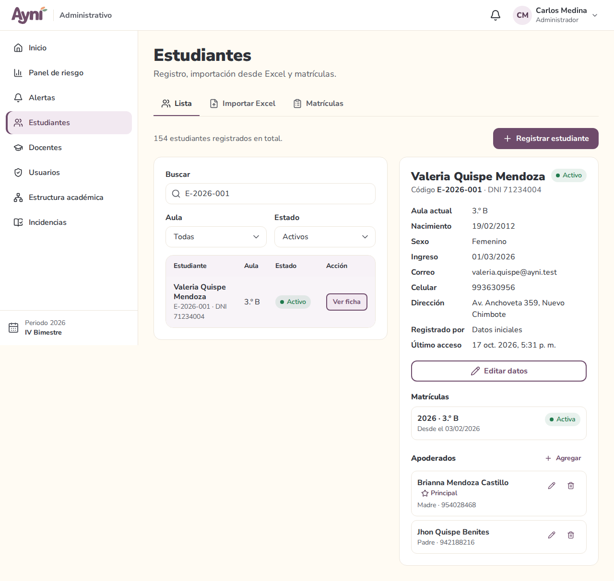
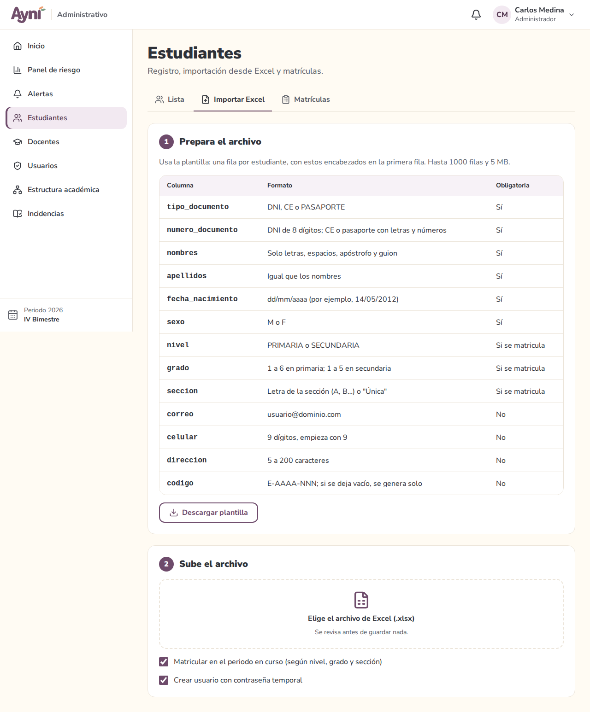
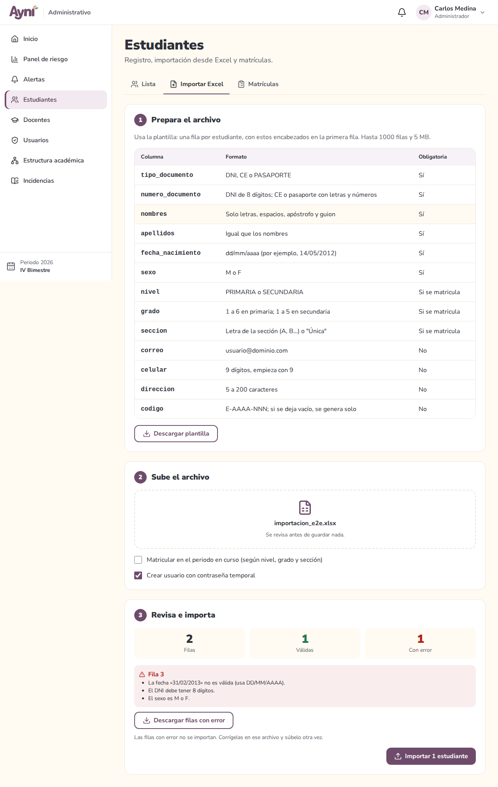
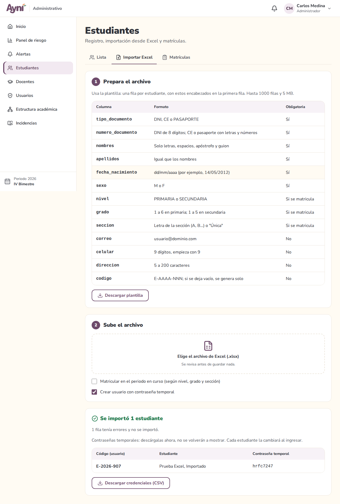
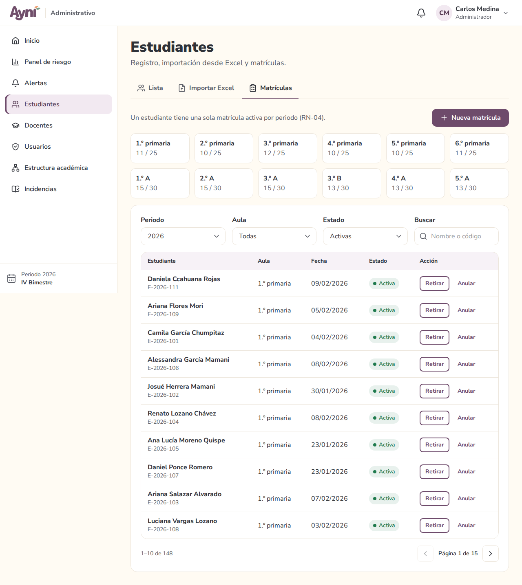

# Manual de usuario — Administrador → Docentes, Estudiantes y Matrículas

> Sección del Módulo 7.

En el menú lateral están **Docentes** y **Estudiantes**. Estudiantes tiene tres pestañas: **Lista**, **Importar Excel** y **Matrículas**.

En la PC, la ficha o el formulario se abre en un panel a la derecha de la lista. En el celular se abre en una ventana.

## 1. Docentes

La lista muestra a cada docente con su DNI, su especialidad, el aula que coordina y su estado. El filtro **Estado** indica cuántos hay de cada tipo: activos, de licencia, inactivos o todos. **Buscar** encuentra por nombre o DNI.

### Registrar un docente

1. **Nuevo docente**: llena el DNI, los nombres y los apellidos. Lo demás es opcional (fecha de nacimiento, sexo, correo, celular, dirección, especialidad, título y fechas del contrato).
2. Si va a coordinar un aula, elígela en **¿Coordinará un aula?**.
3. **Registrar docente**. El sistema crea su cuenta: **el usuario es su DNI**, con una contraseña temporal que se muestra una sola vez. Si tiene correo, también se le envía. Deberá cambiarla en su primer ingreso.

| Campo | Regla |
|---|---|
| DNI | 8 dígitos. Los docentes se registran solo con DNI y no puede repetirse |
| Nombres y apellidos | Letras, espacios, apóstrofo y guion |
| Fecha de nacimiento | Opcional. Si se indica, la edad debe estar entre 18 y 75 años (RN-23) |
| Título y especialidad | Opcionales. Letras, números, espacios y . , - ( ) |
| Contrato | El fin no puede ser anterior al inicio |

### Ficha y edición

**Abrir** muestra sus datos, el aula que coordina, su tutoría y los **cursos a cargo** en el periodo en curso (se asignan en Estructura académica → Carga y horarios). **Editar datos** permite corregirlos y cambiar su estado:

- **Activo**: trabaja normalmente.
- **De licencia**: sigue con su cuenta, pero se distingue en la lista.
- **Inactivo**: ya no trabaja en el colegio. **Su cuenta se desactiva** y se cierran sus sesiones. Si vuelve a estar activo, su cuenta se reactiva.

Si se corrige el DNI, también cambia su usuario.

## 2. Estudiantes

Filtra por **aula** del periodo en curso (o **Sin matrícula**) y por **estado**. Los estudiantes que llegaron por importación llevan la marca **Excel**.

### Registrar un estudiante

1. **Registrar estudiante**: tipo y número de documento, nombres, apellidos, fecha de nacimiento y sexo son obligatorios.
2. En **Matricular en** puedes elegir su aula para matricularlo de una vez (opcional).
3. El sistema genera su **código E-AAAA-NNN** (año de ingreso y correlativo, RN-22). Ese código es su usuario, con una contraseña temporal que se muestra una sola vez.

| Campo | Regla |
|---|---|
| Documento | DNI: 8 dígitos. Carné de extranjería: 9 a 12 letras mayúsculas y números. Pasaporte: 6 a 12. No se repite |
| Fecha de nacimiento | Obligatoria y pasada. Al matricular, la edad debe ser coherente: primaria de 5 a 14 años, secundaria de 11 a 20 (RN-23) |
| Correo, celular, dirección | Opcionales. Celular de 9 dígitos que empieza con 9 |

### Ficha, edición y apoderados

**Ver ficha** muestra sus datos, **quién lo registró** (una persona o "Importación Excel"), sus **matrículas** de cada periodo y sus **apoderados**.

- **Editar datos**: corrige los datos personales, la fecha de ingreso y el estado (activo, retirado, trasladado o egresado). Si deja de estar activo, **su cuenta se desactiva**.
- **Apoderados**:
  - **Agregar** pide nombre, parentesco y, si se quiere, celular y correo.
  - Solo uno es el **principal** (RN-24): al marcar a otro como principal, el anterior deja de serlo.
  - El lápiz edita al apoderado y la papelera lo quita.

## 3. Importar estudiantes desde Excel

1. **Prepara el archivo.** **Descargar plantilla** baja un Excel con los encabezados y una fila de ejemplo. Llena una fila por estudiante (hasta 1000 filas y 5 MB). La tabla de la página explica el formato de cada columna. El **código** puede quedar vacío: se genera solo.
2. **Sube el archivo** (.xlsx). Antes de subirlo, decide:
   - **Matricular en el periodo en curso**: usa las columnas nivel, grado y sección para elegir el aula.
   - **Crear usuario con contraseña temporal**: sin esta opción, las cuentas se crean **desactivadas** y se activan después en Usuarios.
3. **Revisa e importa.** El sistema revisa todo **sin guardar nada** y muestra cuántas filas hay, cuántas son válidas y el error de cada fila con su número en Excel.

**Descargar filas con error** baja solo esas filas, con una última columna que explica qué corregir. Corrígelas y súbelas después. **Importar N estudiantes** guarda solo las filas válidas, todas juntas. Si algo falla, no se guarda ninguna.

Al terminar se muestran los códigos y las contraseñas temporales. **Descargar credenciales (CSV)** los guarda en un archivo que se abre con Excel. **Descárgalo en ese momento: las contraseñas no se vuelven a mostrar.**

Errores que se revisan en cada fila:

- documento con formato incorrecto, ya registrado o repetido dentro del archivo;
- fecha imposible;
- edad que no corresponde al nivel;
- sexo distinto de M o F;
- nivel, grado o sección que no existen en el periodo;
- aula sin cupos;
- correo o código ya usados.

Excel suele guardar el DNI como número y pierde el cero inicial (01234567 → 1234567): el sistema lo completa si faltan uno o dos ceros. Las fechas pueden venir como texto (14/05/2012) o como fecha de Excel.

## 4. Matrículas

Arriba se ven los **cupos de cada aula** (matriculados / capacidad). Debajo, la lista de matrículas del periodo, con filtros por aula, estado y búsqueda.

- **Nueva matrícula**:
  - Busca al estudiante (solo aparecen los activos que aún no tienen matrícula en ese periodo).
  - Elige el aula (se indica cuántos cupos le quedan) y la fecha, que no puede ser futura.
  - Cada estudiante tiene **una sola matrícula por periodo** y no se supera la capacidad del aula (RN-04).
- **Retirar**: el estudiante dejó el aula durante el año. Se pide el motivo (de 10 a 300 caracteres). Su historial se conserva.
- **Anular**: la matrícula fue un error. Solo se puede si aún no tiene asistencias, notas, entregas ni incidencias; si ya las tiene, usa **Retirar**.

Una matrícula retirada o anulada puede volver a registrarse con **Nueva matrícula**.

## 5. Problemas frecuentes

| Problema | Solución |
|---|---|
| "Ya hay una persona registrada con ese documento" | La persona ya existe (como docente o estudiante). Búscala en la lista |
| "La edad no es coherente con secundaria" | Revisa la fecha de nacimiento o el aula elegida (RN-23) |
| El archivo no se acepta | Debe ser .xlsx (no .xls ni .csv), de hasta 5 MB, con los encabezados de la plantilla en la primera fila |
| "La sección «D» no existe en 3.º secundaria" | Crea esa aula en Estructura académica o corrige la fila |
| El estudiante no aparece en Nueva matrícula | Ya está matriculado en ese periodo o no está activo |
| "No se puede anular" | La matrícula ya tiene registros académicos: usa **Retirar** |
| Un docente o estudiante no puede ingresar | Revisa que esté activo; si lo está, genera una nueva contraseña en Usuarios |
