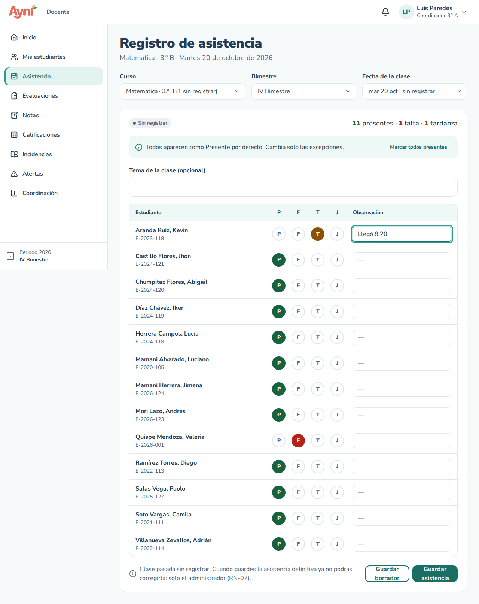
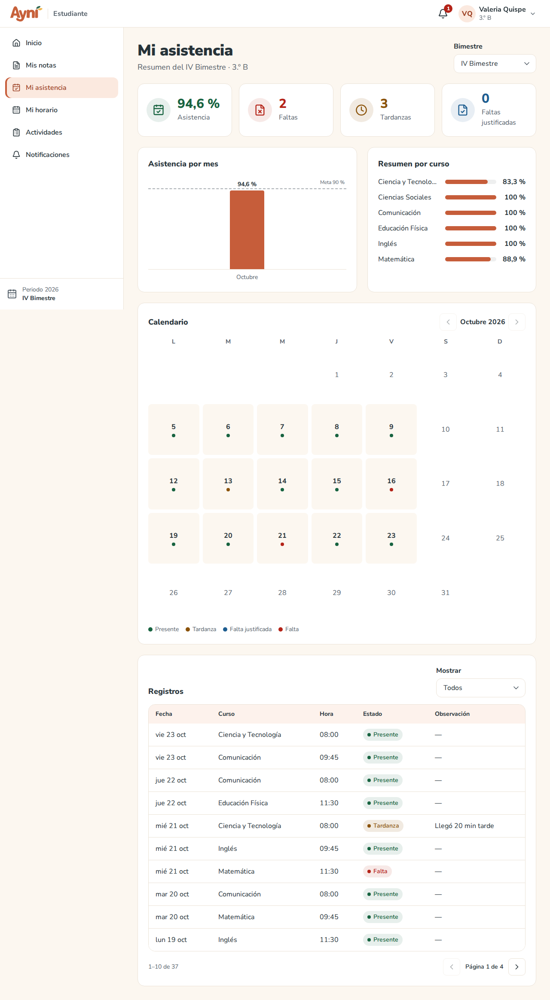
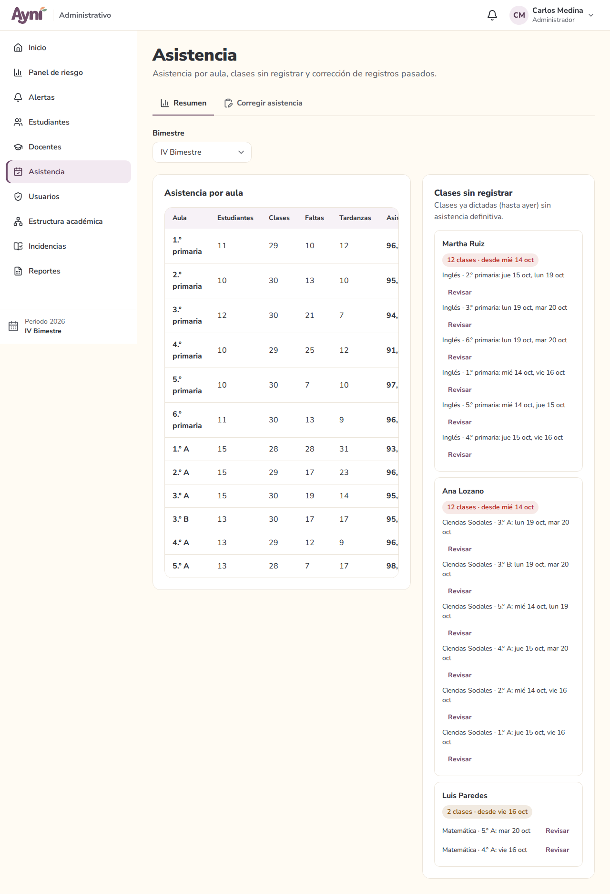
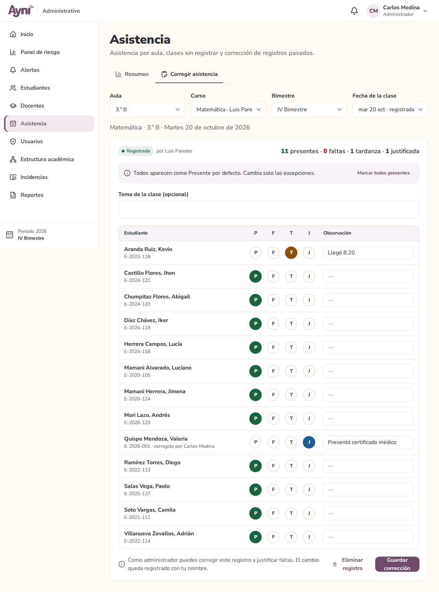

# Manual de usuario — Asistencia

> Sección del Módulo 8.

La asistencia se toma **por clase**: un curso en una fecha. Cada estudiante puede quedar como:

| Letra | Estado | Cuenta como asistencia |
|---|---|---|
| **P** | Presente | Sí |
| **T** | Tardanza | Sí |
| **J** | Falta justificada (exige escribir el motivo) | Sí, no baja el porcentaje |
| **F** | Falta | No |

**Porcentaje de asistencia** = (clases − faltas) ÷ clases (RN-27). Solo cuentan los registros definitivos.

## 1. Docente → Asistencia

1. Elige el **Curso**. Junto a cada curso se ve cuántas clases tiene **sin registrar**.
2. Elige el **Bimestre** y la **Fecha de la clase**. La lista solo trae los días en que el curso tiene clase según el horario, hasta hoy (RN-06). Cada fecha dice si está *sin registrar*, en *borrador* o *registrada*. Por defecto se abre la clase de hoy o la última que falta registrar.
3. Todos aparecen como **Presente**. Marca solo las excepciones (**F**, **T** o **J**) y, si hace falta, escribe una **observación** (hasta 300 caracteres). Para una **J** la observación es obligatoria. **Marcar todos presentes** deshace los cambios.
4. Si a un estudiante se le marca falta y ya acumula faltas en la semana (en cualquier curso), junto a él aparece, por ejemplo, **"3.ª falta esta semana"** (RF-37).
5. Guarda:
   - **Guardar borrador:** queda guardado, pero los estudiantes aún no lo ven ni se les avisa.
   - **Guardar asistencia:** queda definitivo. Los estudiantes lo ven en *Mi asistencia* y a quien tiene falta le llega un aviso.

Arriba se ve el resumen de la clase (presentes, faltas, tardanzas y justificadas).

### Hasta cuándo se puede corregir (RN-07)

- La clase de **hoy** se puede corregir hasta las **11:59 p. m.**: vuelve a guardar con los cambios.
- Pasada la medianoche, la clase queda **de solo lectura** para el docente (aparece con un candado). Solo el administrador puede corregirla.
- Una clase **pasada que nunca se registró** (o que quedó en borrador) todavía se puede registrar una vez. Al guardarla como definitiva queda cerrada para el docente.
- Si el bimestre ya está cerrado, nadie puede modificar su asistencia.

## 2. Estudiante → Mi asistencia

- Arriba: el **porcentaje** de asistencia del bimestre y cuántas **faltas**, **tardanzas** y **faltas justificadas** tiene.
- **Asistencia por mes:** una barra por mes, con la meta del colegio (90 % por defecto) como línea punteada.
- **Resumen por curso:** el porcentaje de cada curso.
- **Calendario:** cada día con clase tiene un punto de color con el estado más serio de ese día (falta, justificada, tardanza o presente). Las flechas cambian de mes.
- **Registros:** la lista de cada clase con su fecha, curso, hora, estado y observación. **Mostrar** filtra solo las faltas, las tardanzas o las justificadas.
- **Bimestre** permite ver los bimestres anteriores.

## 3. Administrador → Asistencia

### Resumen

- **Asistencia por aula:** estudiantes, clases registradas, faltas, tardanzas y porcentaje del bimestre. Las aulas por debajo de la meta se marcan **"Bajo la meta"**.
- **Clases sin registrar:** los docentes que tienen clases ya dictadas (hasta ayer) sin asistencia definitiva, cuántas son y desde cuándo. **Revisar** abre esa clase en la pestaña *Corregir asistencia*.

### Corregir asistencia y justificar faltas (RF-35)

1. Elige el **Aula**, el **Curso**, el **Bimestre** y la **Fecha**.
2. Cambia los estados o justifica una falta (**J** con su motivo, por ejemplo "Presentó certificado médico").
3. **Guardar corrección.** Junto al estudiante queda **"corregido por"** con el nombre de quien lo cambió, y el cambio se guarda en la auditoría con el estado anterior y el nuevo.

El administrador también puede registrar una clase que el docente no registró. **Eliminar registro** borra la asistencia de una clase que **no se dictó** (por ejemplo, un simulacro o una suspensión). Pide un motivo de 10 a 300 caracteres.

## Problemas frecuentes

| Problema | Solución |
|---|---|
| No aparece la fecha que busco | Solo salen los días con clase según el horario, dentro del bimestre y hasta hoy. Revisa el horario en Estructura académica → Carga y horarios |
| "Ya pasó la medianoche…" | El docente ya no puede corregir esa clase (RN-07). Pide la corrección al administrador |
| "Escribe el motivo de la justificación." | Una falta justificada (J) necesita su observación |
| El estudiante no ve su asistencia | Se guardó como borrador: ábrela y pulsa **Guardar asistencia** |
| Un estudiante no aparece en la lista | Solo aparecen los matriculados en el aula en esa fecha. Revisa su matrícula en Estudiantes → Matrículas |
