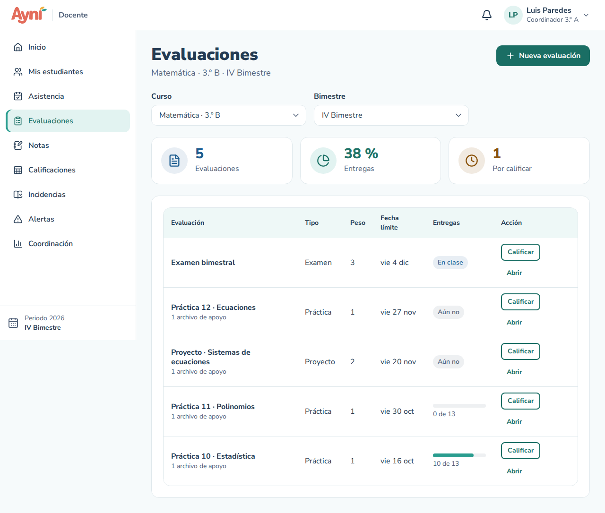
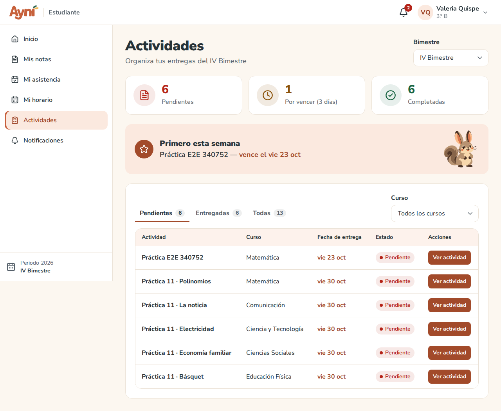
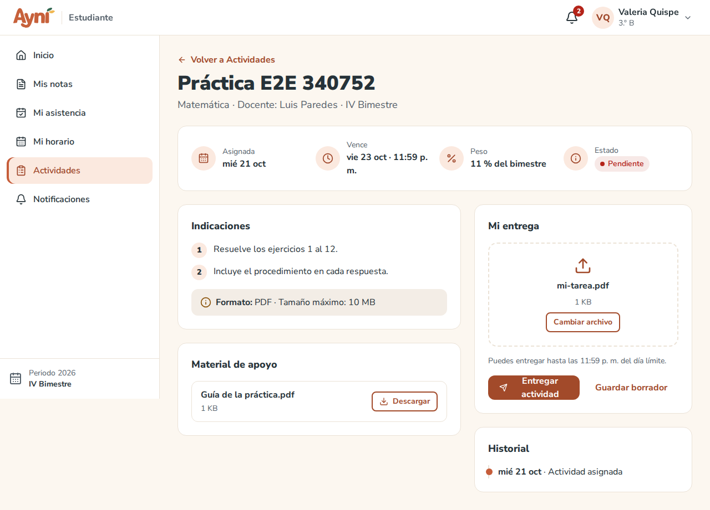
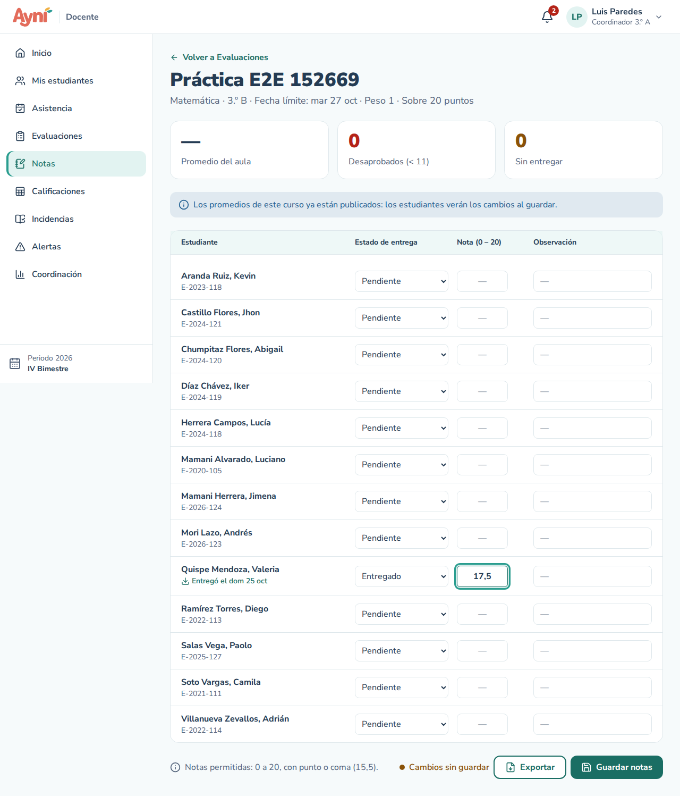
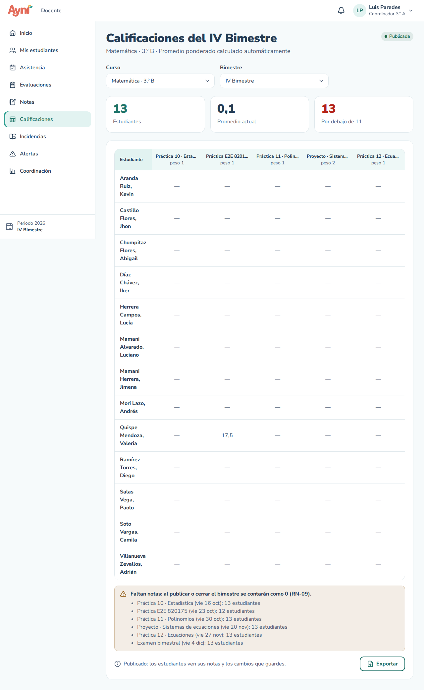
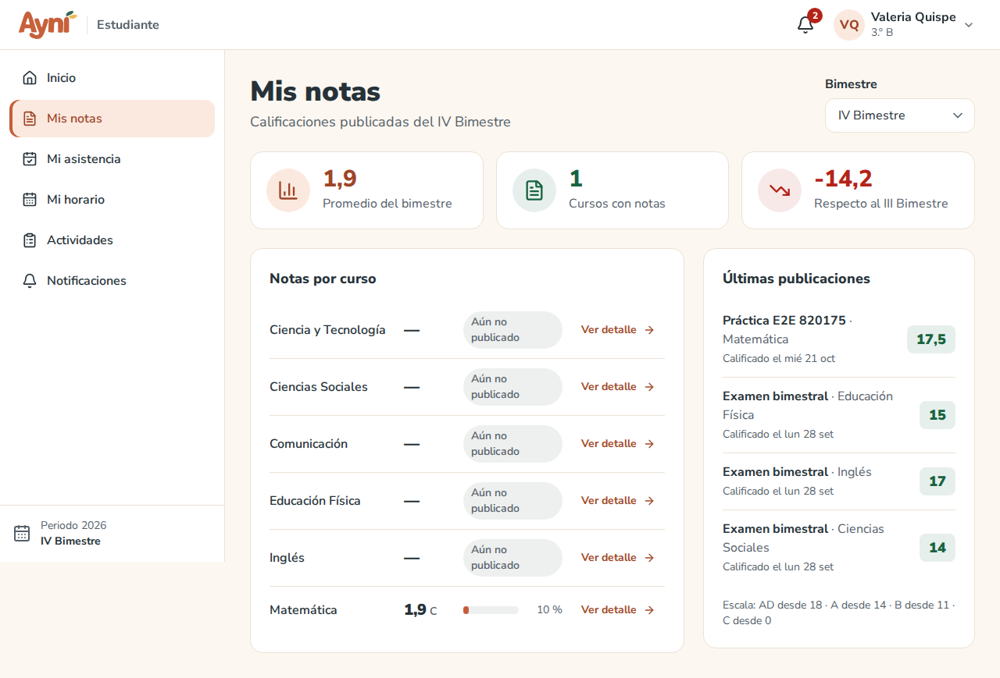
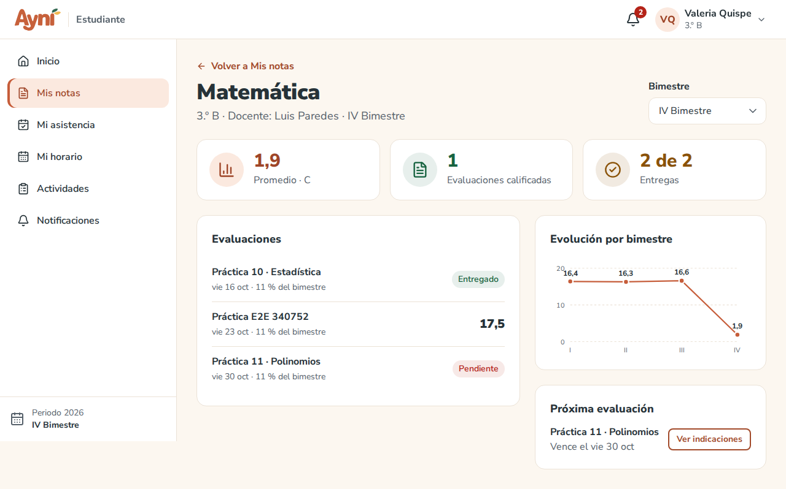
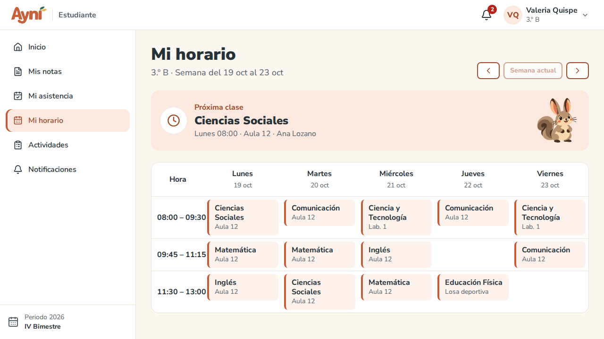

# Manual de usuario — Evaluaciones, entregas, notas y calificaciones

> Sección del Módulo 9.

Las notas van de **0 a 20** (se pueden escribir con punto o coma: `15.5` o `15,5`). Para mostrarlas también se usa la escala literal del colegio: **AD** de 18 a 20, **A** de 14 a 17,99, **B** de 11 a 13,99 y **C** de 0 a 10,99 (el administrador puede cambiarla en Estructura académica → Colegio).

**Promedio del bimestre** (RN-09) = Σ(nota × peso) ÷ Σ(pesos) de las evaluaciones del curso en el bimestre. **Una evaluación sin nota cuenta como 0.** Se redondea a 1 decimal (0,05 sube).

> Ejemplo: Práctica 5 = 11 (peso 1), Práctica 6 sin nota (peso 1), Proyecto = 10 (peso 2) → (11 + 0 + 20) ÷ 4 = 7,75 → **7,8**.

## 1. Docente → Evaluaciones

Elige el **Curso** y el **Bimestre**. Arriba se ven cuántas evaluaciones hay, el % de entregas y cuántas ya vencidas faltan calificar. La tabla muestra cada evaluación con su tipo, peso, fecha límite y cuántos entregaron.

### Crear una evaluación

1. **Nueva evaluación**.
2. Llena el **Título** (3 a 150 caracteres), el **Tipo** (Práctica, Proyecto, Examen…), la **Fecha de asignación** y la **Fecha límite** (dentro del bimestre; la límite no puede ser anterior), el **Peso** (entero de 1 a 10) y, si quieres, las **Indicaciones** (cada línea se muestra como un paso).
3. **Los estudiantes entregan un archivo (PDF)**: déjalo marcado para prácticas y proyectos. Al elegir *Examen* se desmarca solo, porque se rinde en clase.
4. **Crear evaluación**. Se abre la evaluación para agregarle **material de apoyo** (PDF, Word, PowerPoint, Excel, JPG o PNG, hasta 10 MB y 5 archivos).

**Abrir** permite editarla o eliminarla. Una evaluación con entregas o notas ya no se elimina. Si cambias el peso, los promedios se recalculan solos.

## 2. Estudiante → Actividades

- Arriba: cuántas actividades tienes **pendientes**, cuántas **vencen en 3 días** y cuántas **completaste**, y la que vence primero.
- Las pestañas **Pendientes**, **Entregadas** y **Todas**, y el filtro por curso.
- Solo aparecen las actividades que ya se asignaron.

### Entregar una actividad

1. **Ver actividad**: lee las indicaciones, el **peso en % del bimestre** y descarga el material de apoyo.
2. En **Mi entrega**, arrastra tu archivo o pulsa **Seleccionar archivo**. Solo se acepta **PDF de hasta 10 MB** (el sistema revisa el contenido real del archivo, no solo su nombre).
3. **Guardar borrador** guarda tu archivo sin entregarlo (tu docente aún no lo ve). **Entregar actividad** lo entrega.
4. Si entregas después de las **11:59 p. m. del día límite**, la entrega queda como **tardía** (RN-12).
5. El **Historial** muestra cuándo se asignó, cuándo guardaste el borrador, cuándo entregaste y, cuando se publique, tu nota.

Una vez entregada ya no se cambia: si te equivocaste, habla con tu docente.

## 3. Docente → Notas

Llega desde **Calificar** en Evaluaciones, o desde **Notas** eligiendo curso, bimestre y evaluación.

- **Estado de entrega**: el sistema lo calcula (Entregado, Tardío, No entregado o Pendiente) y lo puedes corregir. Si un estudiante subió su archivo, verás **Entregó el …** para descargarlo.
- **Nota**: de 0 a 20 con hasta 2 decimales. Las letras no se pueden escribir; una nota fuera de rango se marca en rojo con el motivo. Las notas por debajo de 11 se resaltan.
- **Observación**: hasta 300 caracteres.
- Mientras haya **Cambios sin guardar**, el sistema avisa si intentas salir de la pantalla.
- **Guardar notas** guarda y recalcula los promedios. **Exportar** descarga la planilla en Excel.

## 4. Docente → Calificaciones

Muestra a cada estudiante con sus notas por evaluación y su **promedio ponderado**, con su letra. Las notas y promedios por debajo de 11 se marcan en rojo. Si faltan notas, un aviso indica en qué evaluaciones y a cuántos estudiantes.

**Publicar promedios** (RF-45):

1. Antes de publicar, el sistema muestra **a quiénes se les pondrá 0** por las evaluaciones sin nota.
2. **Sí, publicar**. Los estudiantes reciben un aviso y desde ese momento ven sus notas y su promedio.
3. Después de publicar puedes seguir corrigiendo notas: los estudiantes verán los cambios al guardar.

El estado se ve arriba: **Borrador** (los estudiantes aún no ven nada), **Publicada** o **Cerrada**.

## 5. Estudiante → Mis notas

- Tu **promedio del bimestre** y la diferencia con el bimestre anterior.
- **Notas por curso**: solo de los cursos cuyo docente ya **publicó** el promedio. Los demás dicen *Aún no publicado*.
- **Últimas publicaciones**: tus notas más recientes.
- **Ver detalle** abre el curso: sus evaluaciones con su nota, tus entregas, la evolución por bimestre y la próxima evaluación.

## 6. Estudiante → Mi horario

Tus clases de la semana, por hora y día, con el ambiente (aula, laboratorio, losa…), y tu **próxima clase**. Las flechas cambian de semana. En el celular se ve un día debajo del otro.

## 7. Administrador → Cierre del bimestre (RF-46, RN-14)

El cierre está en **Estructura académica → Periodos**:

- **Cerrar bimestre** lo cierra a mano.
- Además, **se cierra solo** al pasar su **fecha de cierre de notas**. No hace falta ninguna tarea programada: el sistema lo revisa cada vez que alguien lo usa.

Al cerrarse, lo que no tenga nota se calcula como 0, todos los promedios quedan **CERRADOS** (los estudiantes los ven) y ya no se pueden modificar evaluaciones, entregas, notas ni asistencia de ese bimestre.

## Problemas frecuentes

| Problema | Solución |
|---|---|
| "El archivo debe ser un PDF" | Guarda tu trabajo como PDF (Archivo → Guardar como → PDF). Cambiar el nombre a `.pdf` no sirve |
| "El archivo pesa más de 10 MB" | Reduce el tamaño (por ejemplo, con menos fotos o en menor calidad) |
| No veo mis notas de un curso | Tu docente aún no publica los promedios del bimestre |
| El promedio es muy bajo a mitad del bimestre | Las evaluaciones que aún no tienen nota cuentan como 0 hasta que se califiquen (RN-09) |
| No puedo eliminar una evaluación | Ya tiene entregas o notas. Puedes corregirla con **Abrir** |
| "El bimestre está cerrado…" | Pasó su fecha de cierre o el administrador lo cerró: ya no se modifica |
