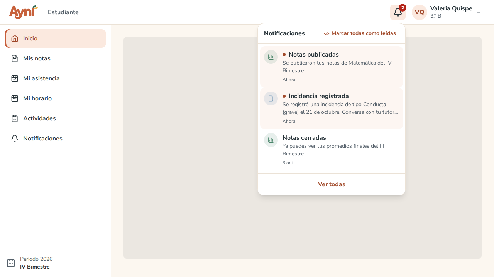
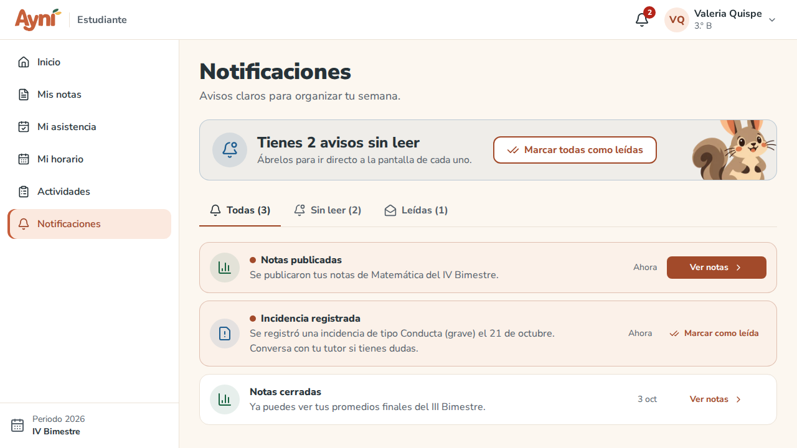
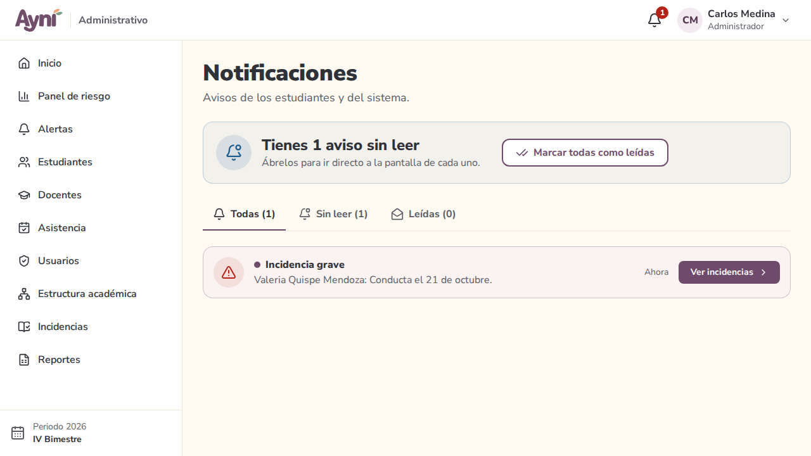
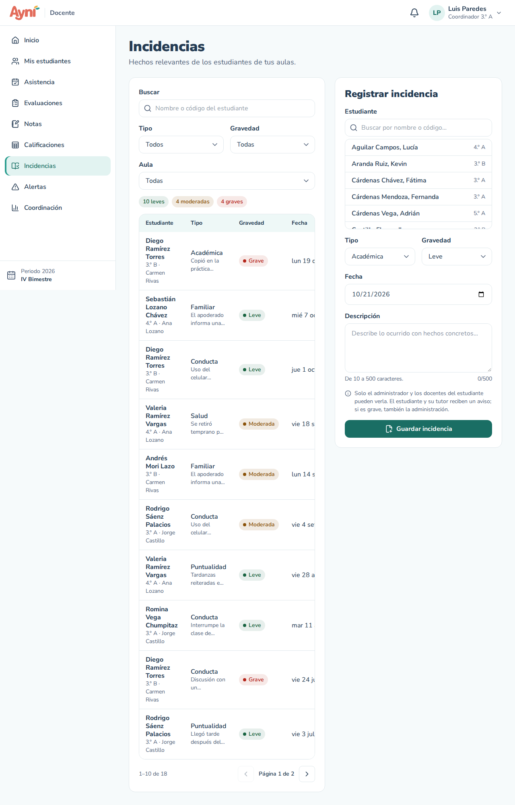
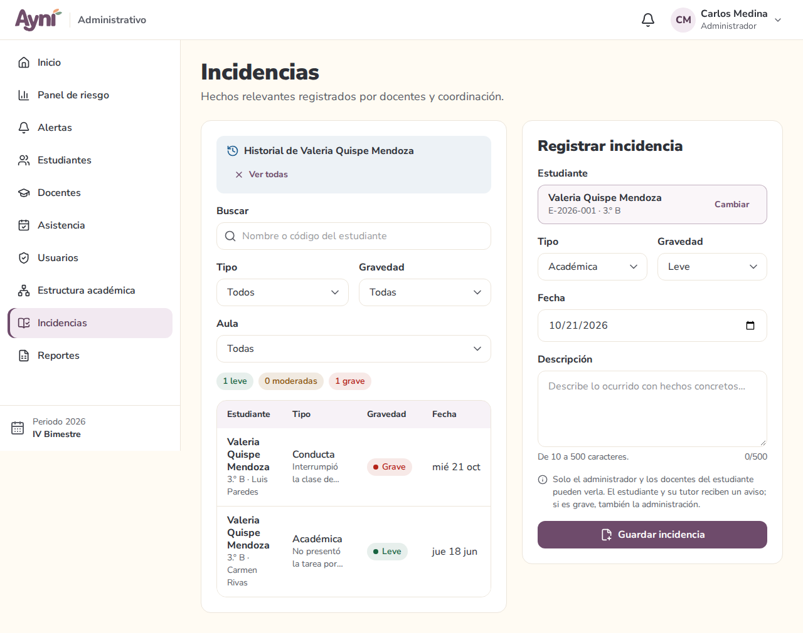

# Manual de usuario — Incidencias y notificaciones

> Sección del Módulo 10.

## 1. La campana (los 3 roles)

En la barra superior, la **campana** muestra en rojo cuántos avisos tienes **sin leer**. Al pulsarla se abren tus **5 avisos más recientes** (primero los no leídos):

- Pulsa un aviso para ir directo a su pantalla; queda marcado como leído.
- **Marcar todas como leídas** quita el contador.
- **Ver todas** abre la pantalla de notificaciones.

El contador se actualiza solo cada minuto mientras tengas AYNI abierto.

### Qué avisa a quién (RF-51)

| Aviso | Lo recibe | Cuándo |
|---|---|---|
| **Notas publicadas** | Cada estudiante del aula | Cuando el docente publica los promedios de un curso |
| **Falta registrada** | El estudiante | Cuando el docente guarda como definitiva una clase con su falta |
| **Actividad por vencer** | El estudiante | Desde 2 días antes de la fecha límite, si aún no entregó |
| **Incidencia registrada** | El estudiante y el tutor de su aula | Cuando se registra una incidencia del estudiante |
| **Incidencia grave** | La administración | Cuando se registra una incidencia **grave** |
| **Cierre del bimestre** | El docente | Desde 7 días antes del cierre de notas, con cuántos cursos le falta publicar |

Los avisos de **actividad por vencer** y **cierre del bimestre** no necesitan ninguna tarea programada: se calculan cuando abres AYNI, y llegan una sola vez. Nadie ve los avisos de otra persona.

## 2. Pantalla de notificaciones

- Arriba, **Vas al día con tus avisos** o cuántos tienes **sin leer**, con el botón **Marcar todas como leídas**.
- Las pestañas **Todas**, **Sin leer** y **Leídas** muestran su cantidad.
- Cada aviso tiene su ícono, cuándo llegó (*Hace 20 min*, *Ayer*, *30 set*) y un botón que lleva a su pantalla (**Ver notas**, **Ver actividad**, **Ver asistencia**, **Ir a calificaciones**, **Ver incidencias**). Los que no llevan a ninguna pantalla tienen **Marcar como leída**.

## 3. Docente y administrador → Incidencias

Una incidencia es un hecho relevante de un estudiante (conducta, académico, puntualidad, salud o familiar). **Solo la ven el administrador y los docentes del estudiante**: su tutor, quienes le dictan algún curso y los coordinadores de su aula, grado, nivel o del colegio. El estudiante no la ve: solo recibe el aviso de que se registró.

### Registrar una incidencia (RF-49)

1. En **Registrar incidencia** (a la derecha; en el celular, debajo de la lista o con el botón de arriba), busca al **Estudiante** por nombre o código y elígelo. Solo aparecen estudiantes con matrícula activa de tus aulas.
2. Elige el **Tipo** y la **Gravedad**: Leve, Moderada o Grave.
3. La **Fecha** viene con hoy; no puede ser futura ni anterior al inicio del periodo.
4. Escribe la **Descripción** con hechos concretos (10 a 500 caracteres).
5. **Guardar incidencia**. El estudiante y su tutor reciben un aviso; si es **grave**, también la administración. Queda registrado quién la registró.

Una incidencia no se edita ni se elimina: si te equivocaste, registra otra que lo aclare.

### Historial y filtros (RF-50)

- Filtra por **Buscar** (nombre o código), **Tipo**, **Gravedad** y, si ves varias aulas, **Aula**. Arriba de la lista se ve cuántas hay de cada gravedad.
- Cada fila muestra el estudiante, su aula y quién la registró, el tipo con la descripción, la gravedad y la fecha.
- Pulsa el **nombre del estudiante** para ver su **historial**. **Ver todas** vuelve a la lista completa. El aviso de una incidencia abre directamente el historial de ese estudiante.

## Problemas frecuentes

| Problema | Solución |
|---|---|
| No encuentro al estudiante al registrar | Solo aparecen estudiantes con matrícula activa en tus aulas. Si es de otra aula, pídelo a su tutor o a la administración |
| "La fecha no puede ser futura ni anterior al inicio del periodo" | Elige una fecha entre el inicio del periodo y hoy |
| El contador de la campana no baja | Abre el aviso o pulsa **Marcar todas como leídas** |
| No me llegó el aviso de una actividad por vencer | Llega desde 2 días antes de la fecha límite, y solo si aún no la entregaste |
