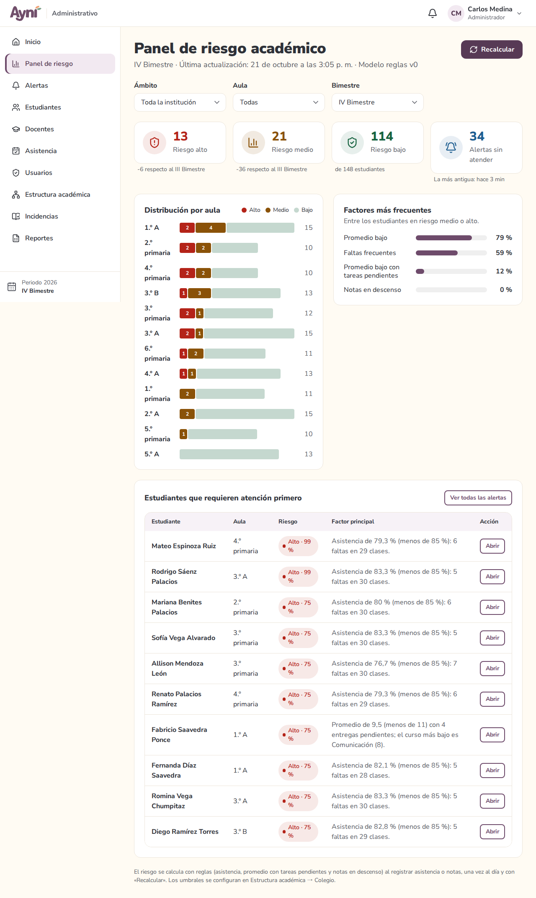
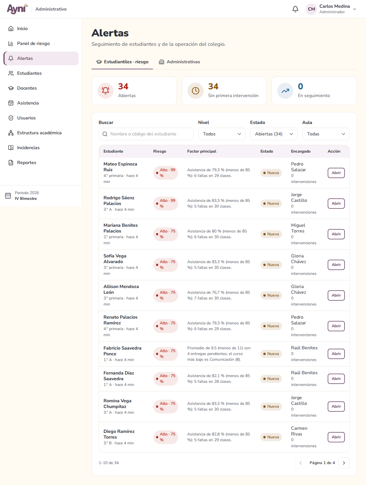
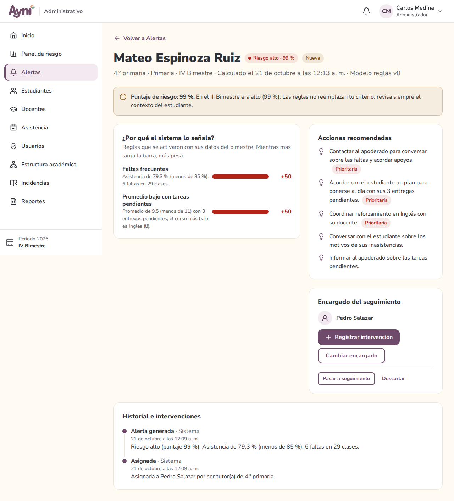
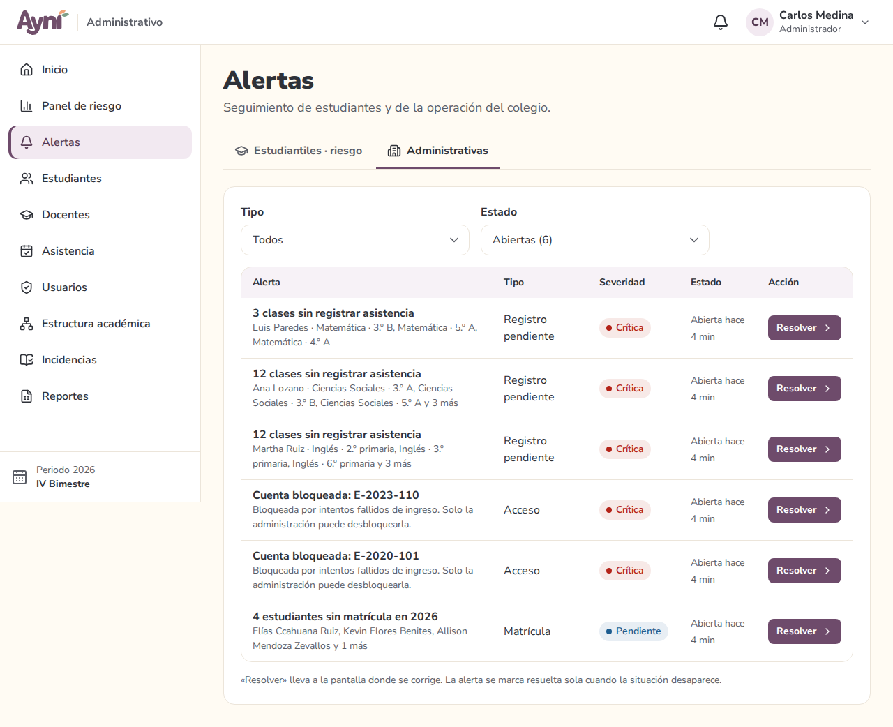
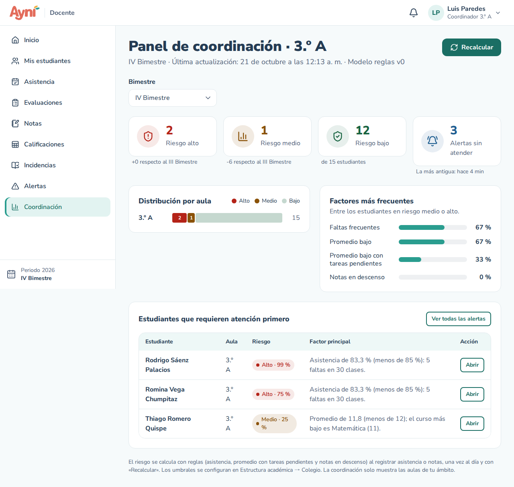
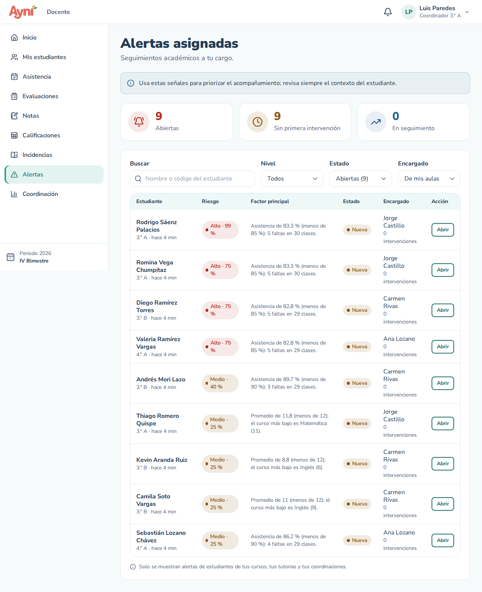

# Manual de usuario — Alertas, panel de riesgo y coordinación

> Sección del Módulo 11.

AYNI calcula el **nivel de riesgo académico** de cada estudiante (bajo, medio o alto) con **reglas**, sin inteligencia artificial (modelo *reglas v0*). En la Unidad 2 un modelo de inteligencia artificial reemplaza estas reglas, con las mismas pantallas. Cuando un estudiante pasa a riesgo medio o alto, crea una **alerta** para que alguien le dé seguimiento.

## 1. Cómo se calcula el riesgo (RN-19)

Se usan los datos del **bimestre en curso**:

| Regla | Riesgo | Cuándo se activa (umbral por defecto) |
|---|---|---|
| **Faltas frecuentes** | Alto | Asistencia menor a **85 %** |
| **Faltas frecuentes** | Medio | Asistencia menor a **90 %** |
| **Promedio bajo** | Alto | Promedio **desaprobatorio**: menor a **11** |
| **Promedio desaprobatorio con tareas pendientes** | Alto | Promedio menor a **11** y **3 o más** entregas vencidas sin entregar (una sola regla) |
| **Promedio bajo** | Medio | Promedio menor a **12** |
| **Tareas pendientes** | Medio | **3 o más** entregas vencidas sin entregar |
| **Notas en descenso** | Medio | Tres notas seguidas que bajan en un mismo curso (por ejemplo, 15 → 13 → 10) |

- La **asistencia** se calcula como en Mi asistencia: (clases − faltas) ÷ clases. Tardanzas y faltas justificadas no restan.
- El **promedio** es el de las notas **ya registradas** en cada curso, promediado entre los cursos. A diferencia del promedio del bimestre, aquí lo que aún no tiene nota **no cuenta como 0**, para no señalar a nadie antes de tiempo.
- Una **entrega pendiente** es una actividad con archivo cuya fecha límite ya pasó y que el estudiante no entregó.
- Todo se mira con **todos los cursos** del estudiante: la asistencia general y el promedio general. Por eso, en **Mis estudiantes**, el nivel puede no coincidir con el promedio o la asistencia de **un solo curso**. Por ejemplo, un estudiante con 65 % de asistencia en Matemática pero 88 % en todos sus cursos tiene riesgo **medio**; uno con 9 en un curso pero 14 de promedio general no tiene riesgo por notas. Debajo de cada nivel se muestra el motivo.
- El nivel es el de la regla más grave. El **puntaje** (de 10 % a 99 %) suma el peso de cada regla activada: una regla de riesgo alto pesa más que tres de riesgo medio.
- Los umbrales se cambian en **Estructura académica → Colegio**.

**Cuándo se recalcula** (no hace falta ninguna tarea programada):
- al guardar la asistencia definitiva de una clase o al guardar notas (solo los estudiantes de esa aula);
- con el botón **Recalcular** del panel;
- una vez al día, con el primer ingreso de cualquier usuario.

## 2. Administrador → Panel de riesgo (RF-57)

- Arriba, cuántos estudiantes hay en riesgo **alto**, **medio** y **bajo**, con la variación respecto al bimestre anterior, y cuántas **alertas sin atender** hay (y desde cuándo).
- Filtra por **Ámbito** (toda la institución, primaria o secundaria), **Aula** y **Bimestre**.
- **Distribución por aula**: barras con los estudiantes en riesgo alto (rojo) y medio (ámbar) de cada aula.
- **Factores más frecuentes**: qué reglas se activan más entre los estudiantes en riesgo.
- **Estudiantes que requieren atención primero**: los de mayor riesgo, con su factor principal y **Abrir** para ir a su alerta.
- **Recalcular** vuelve a calcular el riesgo de todo el colegio y revisa las alertas administrativas.

## 3. Alertas de riesgo

### Quién recibe cada alerta (RN-20, RN-21)

- Hay **una sola alerta activa por estudiante y bimestre**. Si su nivel cambia, la misma alerta se actualiza y el cambio queda en el historial.
- Se asigna al **tutor del aula**. Si el aula no tiene tutor, a la **coordinación** más cercana (aula, grado, nivel o colegio). Si tampoco hay, se crea la alerta administrativa **Aula sin tutor**.
- El encargado recibe un aviso en la campana.
- Si una alerta se cierra o descarta, solo vuelve a abrirse otra en el mismo bimestre si el riesgo **empeora**.

### La lista

- **Docente → Alertas asignadas** muestra las alertas **a tu cargo**. En **Encargado → De mis aulas** ves también las de los estudiantes de tus cursos, tutorías y coordinaciones.
- **Administrador → Alertas → Estudiantiles** muestra todas.
- Arriba: alertas **abiertas**, **sin primera intervención** y **en seguimiento**. Filtra por estudiante, nivel, estado y aula.

### El detalle

- **¿Por qué el sistema lo señala?**: las reglas activadas con los datos reales (por ejemplo, *Asistencia de 78 % (menos de 85 %): 6 faltas en 28 clases*) y cuánto pesa cada una.
- **Acciones recomendadas**: acciones predefinidas por regla (por ejemplo, faltas frecuentes → contactar al apoderado). Las **prioritarias** van primero.
- **Historial e intervenciones**: todo lo que pasó con la alerta, con quién lo hizo y cuándo.

### Atender una alerta (RF-55)

1. **Pasar a seguimiento** cuando empiezas a atenderla. Registrar la primera intervención también la pasa a seguimiento.
2. **Registrar intervención**: tipo (reunión con el apoderado, entrevista con el estudiante, reforzamiento académico, llamada telefónica, derivación a psicología u otro), fecha (entre la creación de la alerta y hoy), qué se hizo (10 a 500 caracteres) y, si quieres, el resultado (hasta 300).
3. **Cerrar alerta** cuando ya no necesita seguimiento: pide una **justificación** (10 a 400 caracteres) y al menos una intervención registrada.
4. **Descartar** si la señal no corresponde (por ejemplo, faltas justificadas fuera del sistema): también pide justificación.

Una alerta **nueva** no se puede cerrar directamente: primero pasa a seguimiento. Cerrada o descartada ya no cambia.

**Quién puede atenderla:** el encargado, el tutor del aula, la coordinación del aula y la administración. Los demás profesores del estudiante la ven, pero no la cambian.

**Cambiar encargado:** solo la administración y la coordinación, eligiendo a otro docente del estudiante (su tutor, uno de sus profesores o la coordinación) y con una justificación. El nuevo encargado recibe un aviso.

## 4. Administrador → Alertas administrativas (RF-56)

Avisos de la operación del colegio. Se revisan al abrir esta pantalla o el panel, y una vez al día:

| Alerta | Cuándo aparece |
|---|---|
| Cuenta bloqueada | Una cuenta se bloqueó por intentos fallidos |
| Estudiantes sin matrícula | Hay estudiantes activos sin matrícula en el periodo en curso |
| Clases sin registrar asistencia | Un docente tiene clases dictadas (hasta ayer) sin asistencia definitiva; es crítica desde 3 clases |
| Curso sin docente | El docente de un curso está inactivo o de licencia |
| Aula sin tutor | Un aula no tiene tutor activo (sus alertas de riesgo van a la coordinación) |
| Cursos sin publicar promedios | Falta una semana o menos para el cierre de notas y hay cursos sin publicar |

**Resolver** lleva a la pantalla donde se corrige (Usuarios, Matrículas, Asistencia, Estructura académica). La alerta se marca **resuelta sola** cuando la situación desaparece, y no se repite mientras siga abierta.

## 5. Docente → Coordinación (RF-58)

Si coordinas un aula, un grado, un nivel o el colegio, **Coordinación** muestra el mismo panel de riesgo **solo de tu ámbito**, con su botón **Recalcular**. Si no coordinas, la pantalla lo indica.

## Problemas frecuentes

| Problema | Solución |
|---|---|
| Un estudiante con muchas faltas no tiene alerta | Pulsa **Recalcular** en el panel. Si su aula no tiene tutor ni coordinación, revisa la alerta administrativa **Aula sin tutor** |
| "Registra al menos una intervención antes de cerrar la alerta" | Registra lo que se hizo con **Registrar intervención** y luego ciérrala |
| "Primero pasa la alerta a seguimiento…" | Una alerta nueva no se cierra directamente: pásala a seguimiento o regístrale una intervención |
| No veo el botón **Cambiar encargado** | Solo lo tienen la administración y la coordinación del aula |
| La alerta dice que el riesgo bajó | Ya no se activa ninguna regla: revisa si se puede cerrar |
