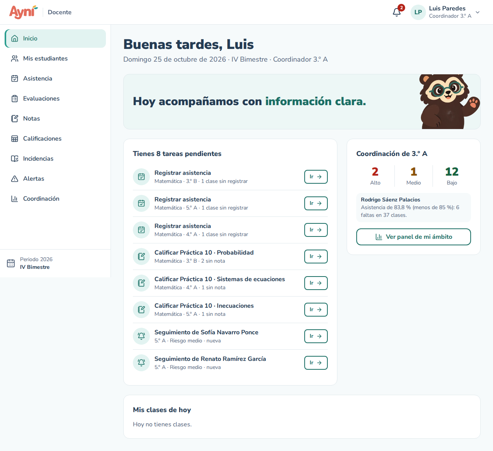
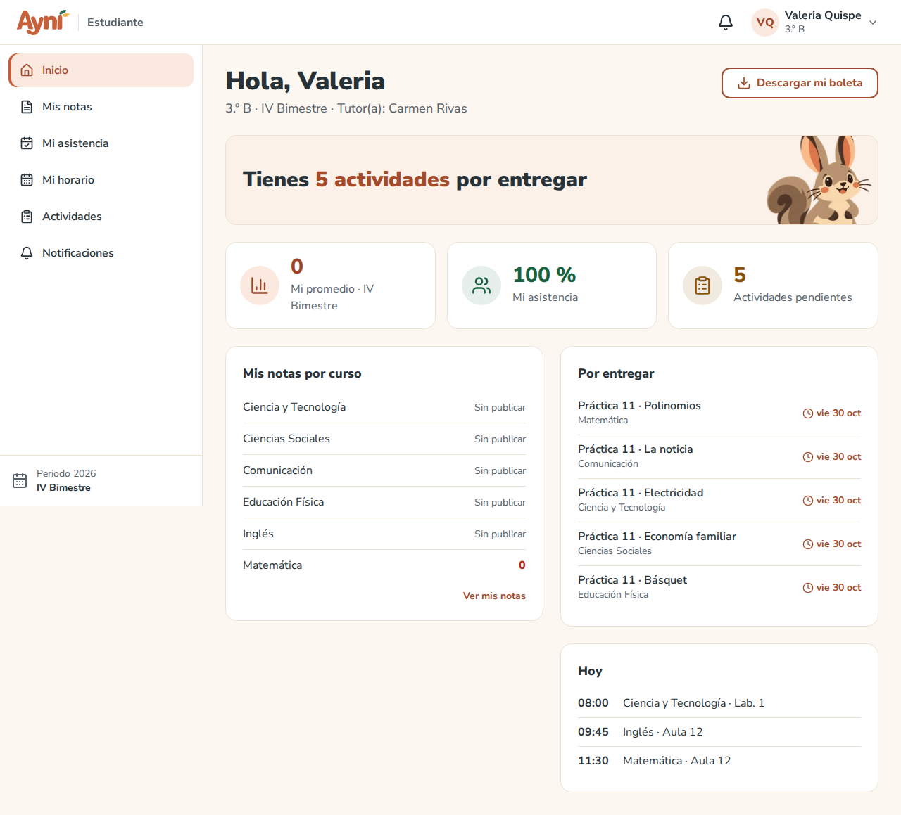
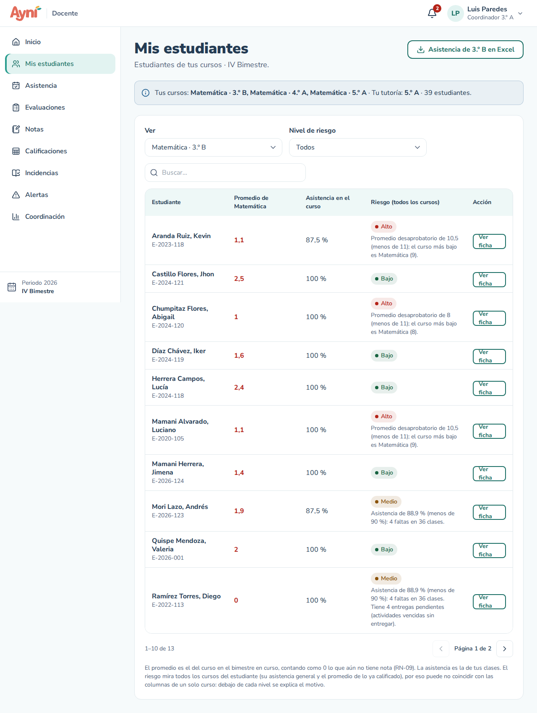
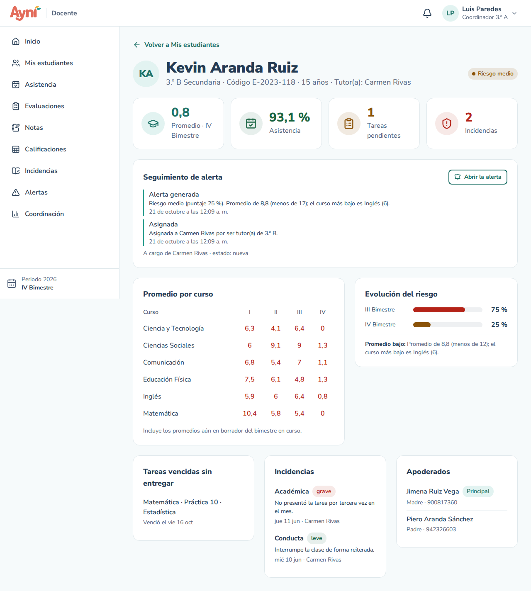
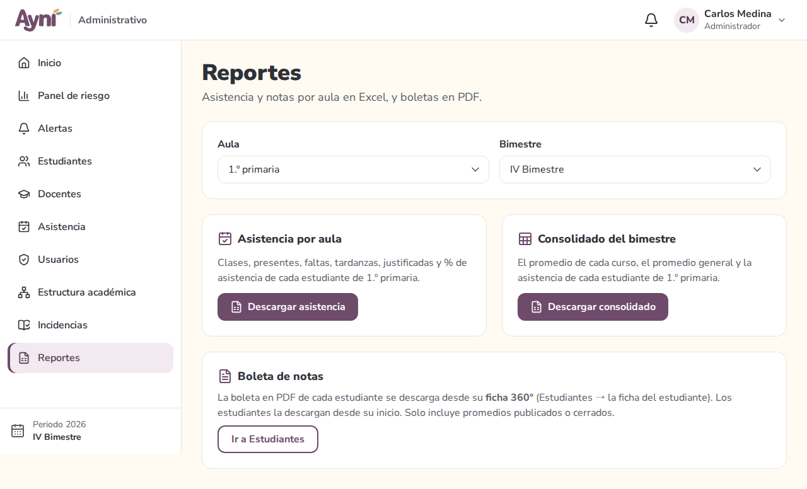

# Manual de usuario — Inicio, ficha 360° y reportes

> Sección del Módulo 12.

Al ingresar, cada rol llega a su **Inicio**: un resumen de lo que necesita saber hoy, con enlaces directos a donde se resuelve cada cosa. Los números se calculan al abrir la pantalla con los datos reales de la base de datos.

## 1. Navegación principal: el inicio de cada rol (RF-59)

Arriba de los tres inicios va el saludo según la hora de Lima (*Buenos días*, *Buenas tardes* o *Buenas noches*), la fecha, el periodo, el bimestre en curso y **cuántos días faltan para el cierre de notas**.

### Administrador


- **Indicadores:** estudiantes matriculados en el periodo, docentes activos (con cuántos coordinan), alertas estudiantiles abiertas y alertas administrativas sin resolver.
- **Necesitan su atención:** las alertas administrativas abiertas más importantes (cuentas bloqueadas, docentes con clases sin registrar, aulas sin tutor…). **Resolver** lleva a la pantalla donde se corrige; **Ver todas las alertas administrativas** abre la lista completa.
- **Avance de registro del bimestre:**

| Barra | Qué cuenta |
|---|---|
| **Asistencia** | Clases ya dictadas (hasta ayer) con asistencia definitiva, de todas las clases dictadas |
| **Notas** | Notas puestas de las evaluaciones cuya fecha límite ya pasó, de todas las que se esperan (una por estudiante) |
| **Promedios** | Cursos con promedios publicados o cerrados, de todos los cursos del periodo |

### Docente



- **Tareas pendientes**, cada una con **Ir** para resolverla:
  - **Registrar asistencia** de las clases dictadas que aún no la tienen (por curso, con cuántas faltan) y de las clases de hoy;
  - **Calificar** las evaluaciones vencidas con estudiantes sin nota;
  - **Seguimiento** de las alertas de riesgo a tu cargo, las de riesgo alto primero.
- Si **coordinas** un aula, grado o nivel: cuántos estudiantes de tu ámbito están en riesgo alto, medio y bajo, quién requiere atención primero y **Ver panel de mi ámbito**. Si no coordinas, un acceso a **Mis estudiantes**.
- **Mis clases de hoy:** hora, curso, ambiente y si ya registraste la asistencia.

### Estudiante



- Tu aula, el bimestre, tu **tutor(a)** y quién **coordina** tu aula: a ellos puedes acudir si necesitas ayuda. También aparecen en **Mi perfil**.
- Cuántas **actividades tienes por entregar** y la lista de las más próximas (al pulsarlas se abren en Actividades).
- **Mi promedio** (solo con los promedios **publicados** por tus docentes), **Mi asistencia** del bimestre y **Por entregar**.
- **Mis notas por curso:** el promedio publicado de cada curso, o *Sin publicar*.
- **Hoy:** tus clases del día.
- **Descargar mi boleta:** la boleta de notas en PDF (ver el punto 4).

> El catálogo de componentes del diseño (M3) sigue disponible en `/{rol}/diseno` para el equipo; no aparece en el menú.

## 2. Docente → Mis estudiantes (RF-61)



- En **Ver** elige uno de **tus cursos** o, si eres **tutor(a)**, **Mi tutoría** para ver a todos los estudiantes de tu aula. Si quieres, filtra por **Nivel de riesgo** o busca por nombre o código.
- En un curso, para cada estudiante: su **promedio en ese curso** en el bimestre en curso (lo que aún no tiene nota cuenta como 0, RN-09; en rojo si es menor que 11) y su **asistencia en tus clases**.
- En **Mi tutoría**: su **promedio general** (el de todos sus cursos) y su **asistencia general**.
- El **riesgo** siempre mira **todos los cursos** del estudiante (su asistencia general y el promedio de lo ya calificado). Por eso puede no coincidir con las columnas de un solo curso; debajo de cada nivel se explica el **motivo** (por ejemplo, *Asistencia de 82 % (menos de 85 %): 9 faltas en 50 clases*).
- **Ver ficha** abre su ficha 360°.
- **Asistencia de {aula} en Excel** descarga el reporte de asistencia del aula (punto 5).

## 3. Ficha 360° del estudiante (RF-60)



Reúne en una sola pantalla todo lo del estudiante:

- **Encabezado:** nombre, aula, código, edad, tutor(a) y nivel de riesgo actual.
- **Indicadores del bimestre en curso:** promedio (incluye los promedios aún en borrador), asistencia, tareas vencidas sin entregar e incidencias.
- **Seguimiento de alerta:** estado, encargado y lo último que pasó, con **Abrir la alerta**.
- **Promedio por curso:** un promedio por bimestre, en rojo los menores que 11.
- **Evolución del riesgo** por bimestre y las reglas activadas.
- **Tareas pendientes**, **Incidencias** y **Apoderados** (con su celular y el principal marcado).

**Quién la ve:** la administración (desde **Estudiantes → la ficha del estudiante → Ver ficha 360° y boleta**) y los docentes de su aula (tutor, profesores de sus cursos y coordinación), desde **Mis estudiantes** o desde una alerta. Un docente de otra aula no puede abrirla.

## 4. Boleta de notas en PDF (RF-62)

- **Estudiante:** **Inicio → Descargar mi boleta**.
- **Administración:** en la ficha 360° del estudiante, **Boleta en PDF**.
- El docente no descarga boletas.

La boleta lleva el nombre del colegio, los datos del estudiante, una tabla con el promedio de cada curso por bimestre, el promedio y el nivel de logro, el promedio general, la asistencia de cada bimestre y la escala de calificación del colegio. **Solo incluye promedios publicados o cerrados** (RN-13): lo que el docente aún tiene en borrador no aparece. El archivo se llama como el código del estudiante, por ejemplo `boleta_e_2026_001.pdf`.

## 5. Administrador → Reportes (RF-63, RF-64)



Elige el **Aula** y el **Bimestre** y descarga:

| Reporte | Columnas |
|---|---|
| **Asistencia por aula** (Excel) | Código, Estudiante, Clases, Presentes, Faltas, Tardanzas, Justificadas, % asistencia |
| **Consolidado del bimestre** (Excel) | Código, Estudiante, un promedio por curso, Promedio general, % asistencia |

El docente también descarga la **asistencia** de las aulas donde enseña, desde **Mis estudiantes**. El consolidado es solo de la administración.

## Prueba tú mismo

1. Ingresa como **administrador** y anota los indicadores del inicio.
2. En phpMyAdmin (opción del panel), compara con estas consultas sobre la base `ayni`:
   ```sql
   -- Estudiantes matriculados del periodo en curso
   SELECT COUNT(*) FROM matricula
   WHERE estado = 'ACTIVA' AND periodo_id = (SELECT id FROM periodo_academico WHERE estado = 'EN_CURSO');
   -- Docentes activos
   SELECT COUNT(*) FROM docente WHERE estado = 'ACTIVO';
   -- Alertas estudiantiles abiertas
   SELECT COUNT(*) FROM alerta_estudiantil WHERE estado IN ('NUEVA', 'EN_SEGUIMIENTO');
   -- Alertas administrativas sin resolver
   SELECT COUNT(*) FROM alerta_administrativa WHERE estado = 'ABIERTA';
   ```
3. Ingresa como **estudiante** (`E-2026-001`) y pulsa **Descargar mi boleta**: revisa que los promedios coincidan con **Mis notas**.
4. Como **administrador**, en **Reportes**, descarga el consolidado de 3.º B y compáralo con la boleta.

## Problemas frecuentes

| Problema | Solución |
|---|---|
| Mi promedio aparece como «—» | Tus docentes aún no publican los promedios del bimestre |
| Un curso no aparece en la boleta | Su promedio sigue en borrador: el docente debe publicarlo (Calificaciones → Publicar promedios) |
| «Mis estudiantes» dice que no tienes cursos | La administración aún no te asigna cursos en el periodo en curso |
| No puedo abrir la ficha de un estudiante | Solo la ven la administración y los docentes de su aula |
| La barra de avance muestra «—» | Aún no hay nada que contar en el bimestre (por ejemplo, ninguna evaluación vencida) |
